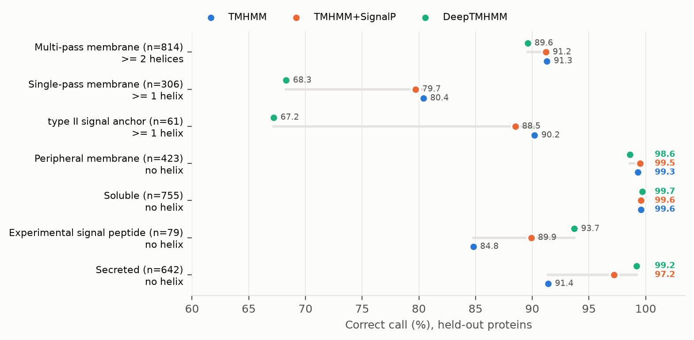
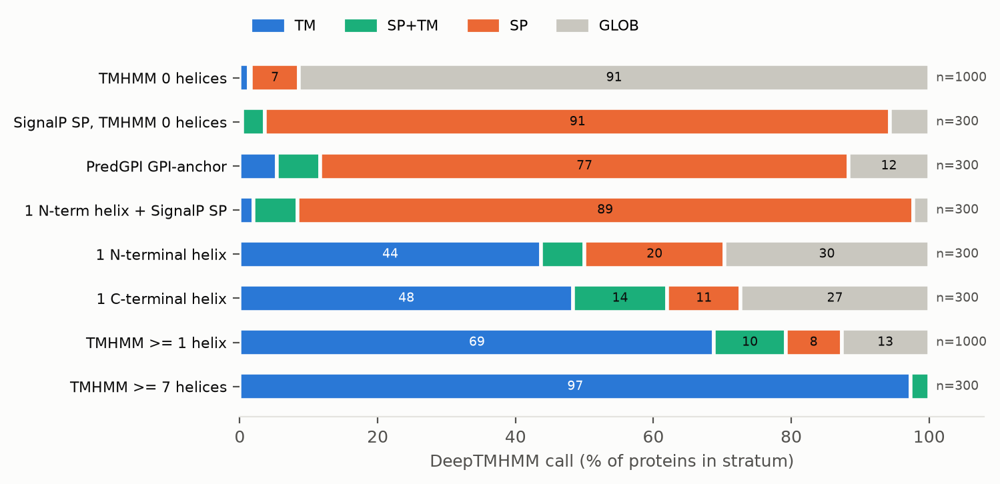
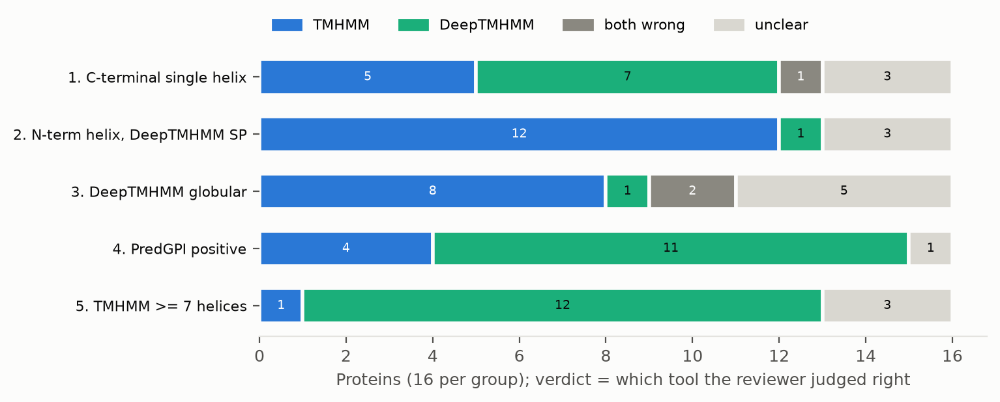

# DeepTMHMM vs TMHMM on fungal proteins

BFD functional annotation benchmark, 2026-11-06.

**Summary.** DeepTMHMM separates signal peptides from transmembrane (TM) helices
much better than TMHMM. It misses many single-pass anchors, mostly type II
signal anchors, which it calls signal peptides. A simple rule, TMHMM plus a
SignalP 6 filter, keeps most of DeepTMHMM's signal-peptide gain without that
loss. TMHMM and SignalP 6 are already computed for every BFD genome. DeepTMHMM
would cost about 5,400 GPU-hours (estimated) even with the faster driver, so it
stays out of this BFD release.

## 1. What was compared

| Tool | Version and settings |
| --- | --- |
| TMHMM | 2.0, `--short` |
| DeepTMHMM | 1.0 academic, private fast image, `--topo-batch 1` (same output as stock `predict.py`) |
| SignalP | 6.0, eukaryote, fast mode (BFD pipeline settings) |
| TMHMM+SignalP | TMHMM helices; drop the first helix when SignalP calls a signal peptide and the helix starts at or before the cleavage site + 5 |

- **SwissProt set (with truth).** 3,741 reviewed fungal UniProt proteins with
  experimental evidence: multi-pass membrane 966, single-pass membrane 333,
  peripheral membrane 488, soluble cytosol/nucleus 1,000 (sampled from 3,258),
  experimental signal peptide 168, experimentally secreted 847, and 160 with
  experimental helix or topology features.
- **BFD sample (no truth).** Proteins from the current BFD tables, stratified by
  the TMHMM and SignalP calls, across 19 phyla (Section 4).
- **Held out.** DeepTMHMM was trained on 3,576 UniProt proteins
  ([DeepTMHMM.3line](https://biolib-public-assets.s3.eu-west-1.amazonaws.com/deeptmhmm/DeepTMHMM.3line)).
  All results use only proteins with < 30% identity over ≥ 50% of the query
  to any training protein (MMseqs2). This removed 583 of 3,741 SwissProt
  proteins. Results on all proteins differ by 2 points or less.

## 2. SwissProt results

| Set (held out) | n | Correct call | TMHMM | TMHMM + SignalP | DeepTMHMM |
| --- | --- | --- | --- | --- | --- |
| Multi-pass | 814 | ≥ 2 helices | 91.3% | 91.2% | 89.6% |
| Single-pass | 306 | ≥ 1 helix | 80.4% | 79.7% | 68.3% |
| Single-pass, type II | 61 | ≥ 1 helix | 90.2% | 88.5% | 67.2% |
| Peripheral membrane | 423 | no helix | 99.3% | 99.5% | 98.6% |
| Soluble | 755 | no helix | 99.6% | 99.6% | 99.7% |
| Experimental signal peptide | 79 | no helix | 84.8% | 89.9% | 93.7% |
| Secreted | 642 | no helix | 91.4% | 97.2% | 99.2% |
| Experimental helices, all placed | 116 | exact | 50.0% | 50.0% | 45.7% |
| Experimental N-terminus side | 95 / 84 | in or out | 63.2% | not scored | 79.8% |

"All placed" = every experimental helix overlaps a predicted helix by ≥ 5 residues and the counts match. SignalP 6 alone calls a signal peptide in 96.2% of the experimental
signal-peptide set and 95.0% of the secreted set. DeepTMHMM calls SP in 100%
and 98.4%.

## 3. Where each tool fails

- **TMHMM calls signal peptides TM helices.** It calls a helix in 8.6% of
  held-out secreted proteins and 15.2% of the experimental signal-peptide set.
  The SignalP rule cuts the secreted error from 8.6% to 2.8%.
- **DeepTMHMM calls type II signal anchors signal peptides.** It finds no helix
  in 32.8% of type II single-pass proteins (TMHMM: 9.8%). SignalP 6 does not
  make this mistake, so the SignalP rule loses only 1 of 61.
- **DeepTMHMM calls many single anchors globular.** It misses 97 of 306
  held-out single-pass proteins; it calls 74 of these GLOB and 23 SP. Type I (n = 47)
  and type IV tail anchors (n = 25) score the same for both tools (95.7%, 72.0%).
- **DeepTMHMM predicts topology better.** The N-terminus side is right in 79.8%
  of experimental cases, against 63.2% for TMHMM.
- **DeepTMHMM splits helices.** 22% of BFD proteins with helices (644 of 2,892)
  have two DeepTMHMM helices separated by a loop of 3 residues or fewer.
  Merging these pairs does not help on SwissProt: multi-pass (≥ 2 helices)
  falls from 89.6% to 86.9%, and exact helix counts rise only from 50.0% to
  51.7%. Some short loops are real hairpins.
- **Both tools place every helix correctly in only about half** of the 116
  held-out proteins with experimental helix positions.

## 4. BFD sample: agreement between the tools

| Stratum (held out) | n | Same helix count as TMHMM | SignalP SP |
| --- | --- | --- | --- |
| TMHMM 0 helices | 1,000 | 98.4% | 5.7% |
| SignalP SP, TMHMM 0 helices | 300 | 96.3% | 100% |
| PredGPI GPI-anchor | 300 | 76.7% | 77.3% |
| 1 N-terminal helix + SignalP SP | 300 | 7.7% | 100% |
| 1 N-terminal helix | 300 | 40.0% | 12.3% |
| 1 C-terminal helix | 300 | 54.3% | 19.7% |
| TMHMM ≥ 1 helix | 1,000 | 40.0% | 12.0% |
| TMHMM ≥ 7 helices | 300 | 48.7% | 2.0% |

- The tools agree on proteins without helices.
- In the "1 N-terminal helix + SignalP SP" stratum, DeepTMHMM and SignalP agree
  that 96% of TMHMM's helices are signal peptides. This is the case the SignalP
  rule corrects.
- In the "1 N-terminal helix" stratum without a SignalP peptide, DeepTMHMM calls
  20% SP. The SwissProt type II result and the expert review (Section 5) say
  most of these are signal anchors, and TMHMM is right.
- For proteins with 7 or more helices, both tools agree on multi-pass, but the
  exact helix counts agree for only 48.7%.

## 5. Expert review of 80 disagreements

An agent acting as a fungal membrane-protein expert reviewed 80 BFD proteins
(16 per group) where the tools disagree. It used the sequence, Pfam domains
(i-Evalue < 1e-3) and the best SwissProt hit. There is no experimental truth
for these proteins, and the groups were chosen because the tools disagree, so
these counts are not accuracy rates.

| Group | TMHMM right | DeepTMHMM right | Both wrong | Unclear |
| --- | --- | --- | --- | --- |
| 1. C-terminal single helix | 5 | 7 | 1 | 3 |
| 2. N-terminal helix, DeepTMHMM calls SP | 12 | 1 | 0 | 3 |
| 3. DeepTMHMM calls globular | 8 | 1 | 2 | 5 |
| 4. PredGPI positive | 4 | 11 | 0 | 1 |
| 5. TMHMM ≥ 7 helices | 1 | 12 | 0 | 3 |
| Total | 30 | 32 | 3 | 15 |

Patterns the reviewer reported:

- **Group 2 (TMHMM right):** most are type II signal anchors, for example Golgi
  glycosyltransferases (OCH1, MNN9, GT25, GT49, GT90, Fringe), Grx6/7, MAPR
  and V-ATPase subunit e.
- **Group 3 (TMHMM mostly right):** real N-terminal anchors (P450,
  b5 reductase, Tom20) and tail anchors called globular by DeepTMHMM. TMHMM's
  typical false positive here is a GxGxxG dinucleotide-binding motif.
- **Group 4 (DeepTMHMM right):** TMHMM calls the signal-peptide core and the
  C-terminal GPI attachment signal helices. The GPI signal is cleaved, so it is
  not a TM helix.
- **Group 5 (DeepTMHMM right):** DeepTMHMM finds 12 helices in all 8 MFS
  transporters; TMHMM finds 8 to 10.
- **Group 1 (mixed):** TMHMM is right for tail anchors (Tom7, metaxin);
  DeepTMHMM is right for GPI signals (yapsins). Several are spurious short ORFs.
- **The SignalP rule** helped in all 6 cases where it applied and hurt in none.
  A rule based on DeepTMHMM's SP call alone would remove about 12 real type II
  anchors in group 2.
- **Gene models:** 5 look like wrong start codons, 3 like fusions, and 6 like
  spurious short ORFs (details in `review/expert_review.tsv`).

## 6. Run time

DeepTMHMM runs ESM-1b and then 5 topology models, one protein at a time. The
private fast driver (`predict_fast.py`) batches both steps.

| DeepTMHMM run, *V. dahliae* 463 (9,789 proteins), RTX 6000 Ada | Wall time | Residue labels identical to stock |
| --- | --- | --- |
| stock `predict.py` | 57 min | reference |
| fast, topology batch 1 | 55-58 min | 99.99-100% |
| fast, topology batch 4 | 22 min | 99.84% |
| fast, topology batch 8 | 16 min | 99.54% |
| fast, topology batch 16 | 12.7 min | 99.34% |
| stock `predict.py`, 8 CPU cores, 300 proteins | 3 h 17 min | (about 110x slower than GPU) |

- A full BFD pass (about 261 M proteins, estimated from proteome file sizes)
  would take about 25,000 GPU-hours with the stock driver, or about
  5,400 GPU-hours at topology batch 16 (estimated).
- TMHMM took 78-160 s and SignalP 6 took 20-28 s on the same 2,300-4,200
  protein BFD benchmark sets.

## 7. Recommendation and open questions

1. Keep TMHMM in BFD. Add the SignalP rule as a derived column or view: a TMHMM
   helix that overlaps a SignalP 6 signal peptide is not counted as TM.
2. Do not run DeepTMHMM on all of BFD now. If its topology (N-terminus side) is
   needed for a subset, use the fast image at topology batch 4 (2.6x faster,
   99.84% identical labels).
3. Treat GPI-anchor predictions without a signal peptide with caution.
4. Open: should helix counts for multi-pass proteins come from DeepTMHMM?
   The expert review favours it for MFS transporters, but SwissProt multi-pass
   accuracy is slightly lower than TMHMM's (89.6% vs 91.3%).
5. Open: the expert review is one reviewer on 80 proteins with no experimental
   truth. A second reviewer or a curated topology set would firm up groups 1
   and 3.

## 8. Files and methods

All paths are under `analysis/deeptmhmm_vs_tmhmm/` in `Fungi_BFD_runs`.

| File | Content |
| --- | --- |
| `swissprot/build_bench.py`, `swissprot/labels.tsv` | UniProt queries and labels; downloads dated 2026-11-06 |
| `sample_bfd.sh`, `sample_bfd_neg.py`, `sample_bfd_gpi.sh` | BFD stratified sampling (seed 20261106) |
| `run_tools.sh` | TMHMM, SignalP 6 and DeepTMHMM on one set |
| `analyze.py`, `combined_rule.py` | Scoring; `results/summary.txt`, `results/combined_rule.txt` |
| `results/*_per_protein.tsv` | Per-protein calls |
| `review/expert_review.tsv`, `review/expert_review.md` | Expert review |
| `make_figures.py`, `figures/` | Figures (PNG and PDF) |

The DeepTMHMM training set, sequence files and tool outputs are kept on HPCC
and not committed. `predict_fast.py` and the fast image stay private under the
DeepTMHMM academic license.
