# Summary

This report describes node-level synonymous divergence (dS) of paralogs in 7,384 genomes with a finished
paralogoscope table. The method is: wgd dmd families, identical-CDS collapse, yn00 dS on sampled pairs
(k = 5 per node, gates dS <= 2.5 and >= 30 codons), and nodes from a neighbour-joining tree on protein identity.
All values below are computed from `tables/` in this folder. Nothing here is a claim about individual genomes
without independent evidence. A flag from dS is a screening result.

Limits that apply to every result:

- yn00 dS reads low above about 0.5 and saturates near 2 (Section 8). Only dS 0 to about 1.5 carries position information.
  The median share of nodes with a usable dS per genome is 0.26. The rest lie beyond the identity window.
- The data cannot detect old fungal WGDs (Saccharomycetaceae, Mucorales). They fall in the old or saturated mass.
  Question 2 is therefore: which genomes carry a recent genome-scale duplication
  (hybrid, heterokaryon or dikaryon assembled with both genomes, or a mixed assembly).
- Aneuploidy is not visible.
- Clade differences are partly confounded with assembly source and technology (Section 6).

# 1. Data and bins

Bins of node dS: **Z** identical (dS = 0), **H** (0, 0.05], **Y** (0.05, 0.3], **MID** (0.3, 1.5], **OLD** (1.5, 2.5],
and **BEYOND** (no usable dS). Shares use two denominators: all nodes (`shareAll_*`) and nodes with a usable dS.
Genome-level intervals come from a family-level cluster bootstrap. Genome statistics are medians per clade,
and genomes are never pooled by node.

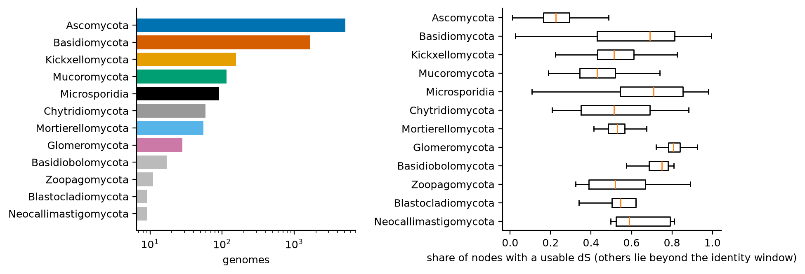

*Share of nodes with a usable dS, by phylum.*

# 2. Composition by taxonomic group

Phylum medians over genomes (columns `med_*`; bootstrap intervals are in `tables/clade_summary_phylum.tsv`).

| phylum | n_genomes | n_genera | med_frac_nodes_with_ds | med_shareAll_Z | med_shareAll_H | med_shareAll_Y | med_shareAll_MID | med_nodes_per_1000_genes | med_share_2gene_fam | med_busco_duplicated_pct | med_te_per_1000_genes |
|---|---|---|---|---|---|---|---|---|---|---|---|
| Ascomycota | 5160 | 1215 | 0.225 | 0.000287 | 0.00099 | 0.00733 | 0.0354 | 284 | 0.518 | 0.4 | 0.0972 |
| Basidiomycota | 1654 | 476 | 0.69 | 0.00378 | 0.0178 | 0.142 | 0.234 | 446 | 0.471 | 0.7 | 0.288 |
| Kickxellomycota | 157 | 15 | 0.514 | 0.00122 | 0.0126 | 0.107 | 0.143 | 257 | 0.552 | 0.8 | 0.181 |
| Mucoromycota | 116 | 39 | 0.43 | 0.00731 | 0.0103 | 0.0464 | 0.113 | 473 | 0.508 | 11.1 | 1.34 |
| Microsporidia | 91 | 48 | 0.709 | 0.0864 | 0.0788 | 0.17 | 0.167 | 292 | 0.567 | 0.3 | 0.806 |
| Chytridiomycota | 59 | 39 | 0.514 | 0.00664 | 0.00816 | 0.0409 | 0.122 | 360 | 0.537 | 2.4 | 0.328 |
| Mortierellomycota | 55 | 14 | 0.53 | 0.00322 | 0.00102 | 0.0373 | 0.163 | 427 | 0.578 | 7.5 | 0.986 |
| Glomeromycota | 28 | 14 | 0.807 | 0.00196 | 0.00727 | 0.186 | 0.428 | 654 | 0.377 | 1 | 3.02 |
| Zoopagomycota | 11 | 8 | 0.519 | 0.0236 | 0.00918 | 0.0492 | 0.144 | 315 | 0.563 | 1.9 | 0.155 |

Fifteen largest classes (n >= 10 eligible):

| class | n_genomes | n_genera | med_shareAll_Z | med_shareAll_H | med_shareAll_Y | med_shareAll_MID | med_nodes_per_1000_genes | med_share_2gene_fam |
|---|---|---|---|---|---|---|---|---|
| Sordariomycetes | 1614 | 336 | 0.00018 | 0.000482 | 0.00296 | 0.0253 | 315 | 0.499 |
| Agaricomycetes | 1172 | 350 | 0.00483 | 0.0281 | 0.188 | 0.301 | 485 | 0.448 |
| Eurotiomycetes | 744 | 92 | 0.000181 | 0.000796 | 0.00584 | 0.0312 | 354 | 0.479 |
| Pichiomycetes | 665 | 87 | 0 | 0.00164 | 0.0154 | 0.0714 | 225 | 0.584 |
| Dothideomycetes | 612 | 235 | 0.000311 | 0.000604 | 0.00299 | 0.0216 | 291 | 0.507 |
| Lecanoromycetes | 406 | 176 | 0 | 0.000309 | 0.00299 | 0.0361 | 262 | 0.526 |
| Saccharomycetes | 365 | 52 | 0.001 | 0.00395 | 0.0239 | 0.0752 | 243 | 0.596 |
| Leotiomycetes | 236 | 95 | 0.000723 | 0.00157 | 0.00918 | 0.0409 | 312 | 0.489 |
| Tremellomycetes | 220 | 42 | 0.000714 | 0.00153 | 0.00764 | 0.0305 | 230 | 0.538 |
| Dipodascomycetes | 210 | 27 | 0.000604 | 0.0016 | 0.0192 | 0.078 | 233 | 0.564 |
| Kickxellomycetes | 141 | 7 | 0.00109 | 0.0113 | 0.105 | 0.143 | 251 | 0.551 |
| Pezizomycetes | 121 | 32 | 0.00398 | 0.00743 | 0.0912 | 0.153 | 306 | 0.525 |
| Mucoromycetes | 106 | 36 | 0.00793 | 0.0103 | 0.0488 | 0.116 | 479 | 0.504 |
| Microsporidia (unassigned) | 91 | 48 | 0.0864 | 0.0788 | 0.17 | 0.167 | 292 | 0.567 |
| Microbotryomycetes | 77 | 18 | 0.00342 | 0.0038 | 0.0235 | 0.0848 | 251 | 0.54 |

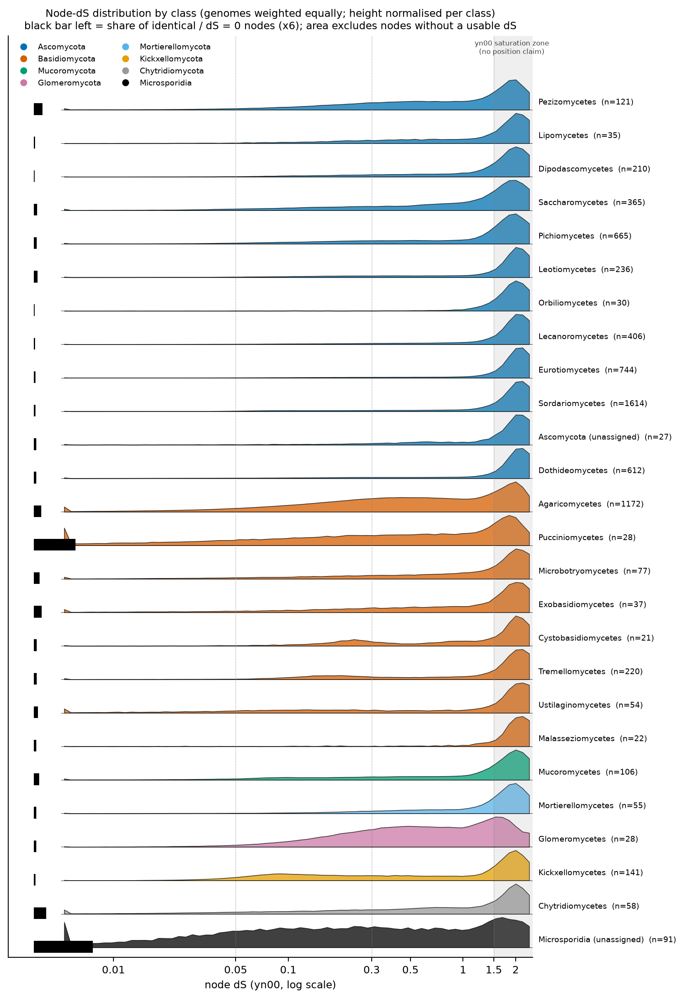

*Node-dS distributions by class. Grey band: yn00 saturation zone (no position claim). Black bar: identical-copy share.*

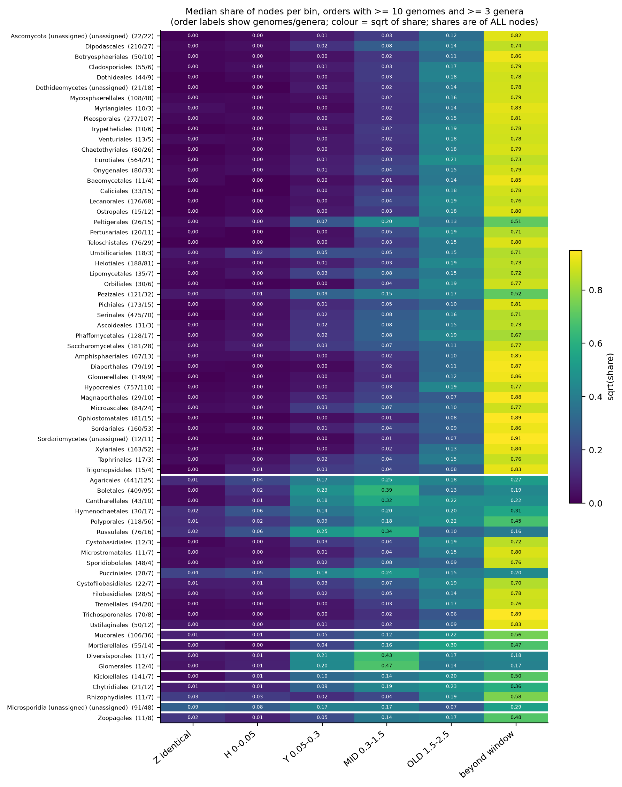

*Bin shares by order (genomes / genera in labels).*

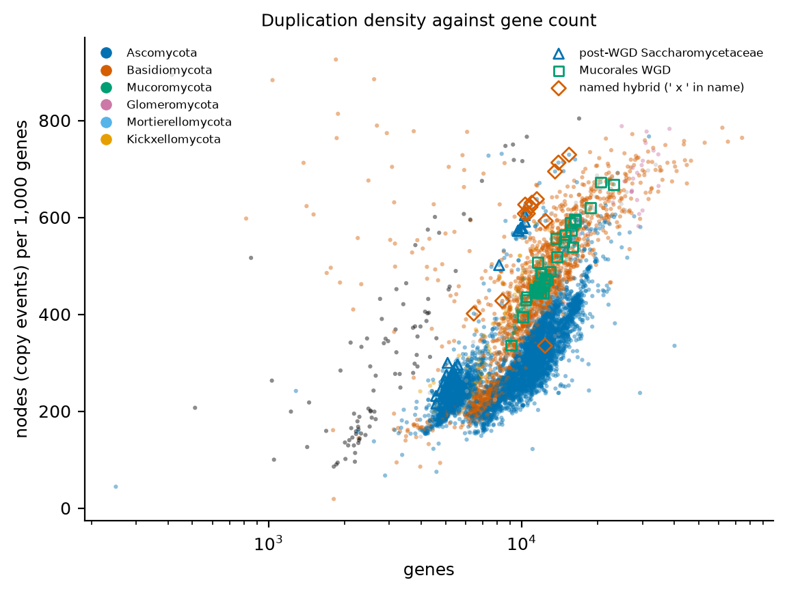

*Nodes per 1,000 genes against dS-bin mass.*

# 3. How much of the variation is taxonomic

Nested random-effects model (taxonomy as a phylogeny proxy; branch lengths ignored), with and without assembly covariates.

| response | adjustment | phylum | class | order | family | genus | genome (residual) |
|---|---|---|---|---|---|---|---|
| BEYOND | no covariates | 0.24 | 0.31 | 0.038 | 0.063 | 0.11 | 0.24 |
| BEYOND | with covariates | 0.34 | 0.23 | 0.04 | 0.063 | 0.11 | 0.22 |
| H | no covariates | 0.22 | 0.17 | 0.0062 | 0.11 | 0.12 | 0.38 |
| H | with covariates | 0.39 | 0.079 | 0.018 | 0.055 | 0.092 | 0.36 |
| MID | no covariates | 0.2 | 0.3 | 0.081 | 0.068 | 0.11 | 0.23 |
| MID | with covariates | 0.13 | 0.29 | 0.09 | 0.067 | 0.13 | 0.29 |
| Y | no covariates | 0.16 | 0.22 | 0.041 | 0.085 | 0.12 | 0.37 |
| Y | with covariates | 0.098 | 0.24 | 0.053 | 0.072 | 0.11 | 0.43 |
| identical | no covariates | 0.18 | 0.16 | 0.01 | 0.12 | 0.077 | 0.45 |
| identical | with covariates | 0.36 | 0.061 | 0.02 | 0.069 | 0.069 | 0.42 |
| nodes_per_1000 | no covariates | 0.31 | 0.32 | 0.019 | 0.078 | 0.094 | 0.18 |
| nodes_per_1000 | with covariates | 0.3 | 0.23 | 0.018 | 0.086 | 0.17 | 0.19 |
| paralog_frac | no covariates | 0.26 | 0.23 | 0.014 | 0.055 | 0.096 | 0.35 |
| paralog_frac | with covariates | 0.42 | 0.14 | 0.0061 | 0.053 | 0.15 | 0.23 |
| two_gene_fam | no covariates | 0.16 | 0.16 | 0.02 | 0.052 | 0.1 | 0.5 |
| two_gene_fam | with covariates | 0.15 | 0.35 | 0.022 | 0.014 | 0.097 | 0.37 |

Reading: `share` is the fraction of total random variance at that level. A large residual or genus share means the trait varies within clades. Large phylum to order shares mean clade identity predicts it.

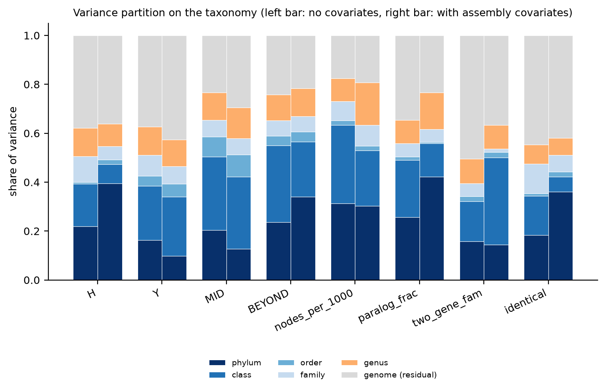

*Variance components by taxonomic level.*

# 4. Question 1: excess of dS = 0 and near-zero paralogs

Outlier flags use robust z within clade (order, then class, then phylum; n >= 10; MAD floors) on unshrunken values.
Flagged rows: identical excess 594, H excess 18, Y excess 49,
MID excess 111, duplication-dense 102, 2-gene-family excess 210
(rows in `outlier_flags.tsv`: 833). These counts are screening hits, not confirmed events. No multiplicity-adjusted claim is made per genome.

Identical-copy excess split by simple descriptors (BUSCO duplicated % and largest identical group). The two groups are a heuristic, not a diagnosis:

| profile | n | med_busco_dup | med_largest_group | med_te_per_1000 | med_ident_per_1000 |
|---|---|---|---|---|---|
| TE/multicopy-like (large group, low BUSCO dup) | 248 | 0.7 | 9 | 0.127 | 11.8 |
| assembly-duplication-like (BUSCO dup >= 20%) | 61 | 53.7 | 6 | 0.283 | 39.8 |
| other | 285 | 1.1 | 3 | 0.13 | 10 |

Classes with the most identical-excess flags:

| phylum | class | n_flagged |
|---|---|---|
| Ascomycota | Sordariomycetes | 145 |
| Ascomycota | Eurotiomycetes | 80 |
| Ascomycota | Dothideomycetes | 71 |
| Basidiomycota | Agaricomycetes | 65 |
| Ascomycota | Pichiomycetes | 62 |
| Ascomycota | Saccharomycetes | 41 |
| Ascomycota | Leotiomycetes | 39 |
| Ascomycota | Lecanoromycetes | 20 |
| Basidiomycota | Tremellomycetes | 19 |
| Basidiomycota | Microbotryomycetes | 11 |
| Ascomycota | Dipodascomycetes | 10 |
| Kickxellomycota | Kickxellomycetes | 9 |

Interpretation (from the framing review, `fable_context.md`): a flag with high BUSCO duplication and many small groups points to
duplicated contigs or haplotigs. A flag with low BUSCO duplication, large groups and high TE counts points to TE-derived models
or multicopy arrays. H excess without Z points to haplotype or heterozygosity depth. Tests that would separate these are listed in Section 10.

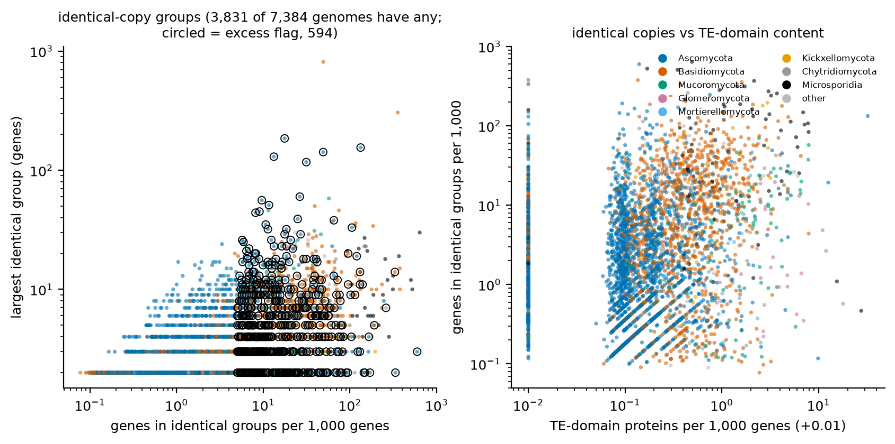

*Identical-copy statistics by clade.*

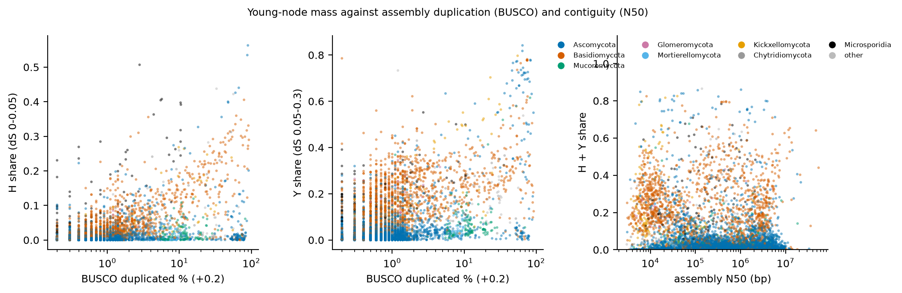

*Young-node mass (H, Y) against BUSCO duplication and N50.*

# 5. Question 2: dS peaks suggesting recent genome-scale duplication, hybrid or mixed assembly

Peaks come from a Gaussian mixture on log dS (dS > 0). A peak counts as *stable* only if all of these hold:
node bootstrap >= 0.8, present at >= 100 codons, stable under pair resampling (>= 0.8), and position in 0.05 to 1.5.
Components outside that window are not treated as duplication peaks.

The catalogue file lists 1181 components in 1132 genomes. Of these, 1181 pass the stability rules above (the catalogue is already filtered; this is a check). Stable and with assembly support (BUSCO dup >= 40% and gene count >= 1.5x clade median): 115 components in 113 genomes.

| phylum | components | genomes |
|---|---|---|
| Basidiomycota | 668 | 636 |
| Ascomycota | 337 | 328 |
| Kickxellomycota | 52 | 52 |
| Microsporidia | 39 | 36 |
| Glomeromycota | 28 | 25 |
| Chytridiomycota | 17 | 17 |
| Mucoromycota | 12 | 12 |
| Basidiobolomycota | 13 | 11 |
| Entomophthoromycota | 5 | 5 |
| Neocallimastigomycota | 3 | 3 |
| Zoopagomycota | 2 | 2 |
| Mortierellomycota | 2 | 2 |
| Blastocladiomycota | 1 | 1 |
| Monoblepharomycota | 1 | 1 |
| unassigned | 1 | 1 |

Top 40 stable peaks with assembly support (sorted by BUSCO duplicated %):

| genome | phylum | class | peak_dS | support_node_boot | busco_duplicated_pct | genes_ratio_clade | share_2gene_fam |
|---|---|---|---|---|---|---|---|
| Epichloe_coenophiala_ATCC_90664 | Ascomycota | Sordariomycetes | 0.0659 | 1 | 91.5 | 1.99 | 0.186 |
| Scleroderma_citrinum_hr | Basidiomycota | Agaricomycetes | 1.48 | 0.97 | 89.9 | 1.72 | 0.788 |
| Scleroderma_citrinum_hr | Basidiomycota | Agaricomycetes | 0.511 | 1 | 89.9 | 1.72 | 0.788 |
| Puccinia_polysora_GD1913 | Basidiomycota | Pucciniomycetes | 0.13 | 0.94 | 87.9 | 2.25 | 0.766 |
| Favolaschia_claudopus_CIRM-BRFM_2984 | Basidiomycota | Agaricomycetes | 0.152 | 1 | 87.5 | 4.57 | 0.136 |
| Lactarius_tabidus_Fr._1825 | Basidiomycota | Agaricomycetes | 0.594 | 1 | 86.2 | 2.37 | 0.684 |
| Coniochaeta_sp._2T2.1_2T2.1 | Ascomycota | Sordariomycetes | 0.278 | 1 | 83.5 | 2.26 | 0.813 |
| Rhizopus_sp._PT2906_PT2906 | Mucoromycota | Mucoromycetes | 0.0827 | 1 | 82 | 1.71 | 0.709 |
| Agroathelia_delphinii_SD | Basidiomycota | Agaricomycetes | 0.278 | 1 | 81.3 | 1.55 | 0.781 |
| Exophiala_dermatitidis_EXF-5586 | Ascomycota | Eurotiomycetes | 0.191 | 1 | 80.8 | 1.54 | 0.86 |
| Cryoendolithus_antarcticus_CCFEE_5527 | Ascomycota | Dothideomycetes | 0.551 | 1 | 79.9 | 1.65 | 0.845 |
| Friedmanniomyces_endolithicus_CCFEE_6250 | Ascomycota | Dothideomycetes | 0.407 | 1 | 79.2 | 1.52 | 0.853 |
| Vermiconidia_calcicola_CCFEE_5714 | Ascomycota | Dothideomycetes | 0.258 | 1 | 78.8 | 1.86 | 0.83 |
| Ogataea_polymorpha_x_Ogataea_parapolymorpha_CBS_1977 | Ascomycota | Pichiomycetes | 0.164 | 1 | 78.6 | 2.92 | 0.32 |
| Aureobasidium_sp._EXF-3400_EXF-3400 | Ascomycota | Dothideomycetes | 0.805 | 1 | 77.6 | 2.12 | 0.815 |
| Aureobasidium_sp._EXF-12298_EXF-12298 | Ascomycota | Dothideomycetes | 0.805 | 1 | 77.6 | 2.05 | 0.823 |
| Verticillium_longisporum_PD589 | Ascomycota | Sordariomycetes | 0.13 | 1 | 77.2 | 1.54 | 0.791 |
| Aureobasidium_sp._DW-1_DW-1 | Ascomycota | Dothideomycetes | 0.164 | 1 | 76.8 | 2.08 | 0.688 |
| Neonothopanus_nambi_BIN_2379 | Basidiomycota | Agaricomycetes | 0.0566 | 1 | 76.1 | 2.32 | 0.598 |
| Agroathelia_rolfsii_MR10 | Basidiomycota | Agaricomycetes | 0.177 | 1 | 75.7 | 1.61 | 0.72 |
| Apiotrichum_sp._PDH3304B_PDH3304B | Basidiomycota | Tremellomycetes | 0.152 | 1 | 75 | 1.86 | 0.878 |
| Apiotrichum_sp._PA4207_PA4207 | Basidiomycota | Tremellomycetes | 0.152 | 1 | 74.9 | 1.87 | 0.877 |
| Apiotrichum_sp._Y4204_Y4204 | Basidiomycota | Tremellomycetes | 0.152 | 1 | 74.9 | 1.86 | 0.877 |
| Apiotrichum_sp._Y4201-1_Y4201-1 | Basidiomycota | Tremellomycetes | 0.152 | 1 | 74.7 | 1.85 | 0.878 |
| Apiotrichum_sp._PL3306B_PL3306B | Basidiomycota | Tremellomycetes | 0.152 | 1 | 74.2 | 1.86 | 0.876 |
| Apiotrichum_sp._PL3309B_PL3309B | Basidiomycota | Tremellomycetes | 0.152 | 1 | 74.2 | 1.86 | 0.879 |
| Debaryomyces_hansenii_TMW_3.1188 | Ascomycota | Pichiomycetes | 0.278 | 1 | 73.8 | 2.16 | 0.861 |
| Pisolithus_thermaeus_11 | Basidiomycota | Agaricomycetes | 0.104 | 1 | 73.6 | 1.77 | 0.706 |
| Hansenula_lynferdii_NRRL_Y-7723 | Ascomycota | Saccharomycetes | 0.35 | 1 | 73.5 | 2.11 | 0.861 |
| Pisolithus_croceorrhizus_2_72 | Basidiomycota | Agaricomycetes | 0.104 | 1 | 73 | 1.95 | 0.724 |
| Debaryomyces_sp._S3305_S3305 | Ascomycota | Pichiomycetes | 0.278 | 1 | 72.5 | 2.11 | 0.865 |
| Aureobasidium_sp._EXF-12344_EXF-12344 | Ascomycota | Dothideomycetes | 0.805 | 1 | 71.2 | 2.02 | 0.807 |
| Millerozyma_farinosa_KCTC_27753 | Ascomycota | Pichiomycetes | 0.324 | 1 | 71 | 1.91 | 0.885 |
| Lodderomyces_metapsilosis_414 | Ascomycota | Pichiomycetes | 0.152 | 1 | 70.9 | 2.23 | 0.824 |
| Neocatenulostroma_microsporum_FJI-L3-BK-P2 | Ascomycota | Dothideomycetes | 0.324 | 1 | 69.9 | 2.33 | 0.783 |
| Saccharomycopsis_fibuligera_x_Saccharomycopsis_cf._fibuligera_KJJ81 | Ascomycota | Saccharomycetes | 0.278 | 1 | 68.2 | 2.11 | 0.875 |
| Rhodosporidiobolus_fluvialis_TZ579 | Basidiomycota | Microbotryomycetes | 1.09 | 1 | 68 | 2.48 | 0.767 |
| Saccharomyces_cerevisiae_x_Saccharomyces_eubayanus_x_Saccharomyces_kudriavzevii_x_Saccharomyces_uvarum_yHQL563 | Ascomycota | Saccharomycetes | 0.937 | 1 | 67.7 | 2.69 | 0.368 |
| Lyophyllum_atratum_CBS_144462 | Basidiomycota | Agaricomycetes | 0.104 | 1 | 67.4 | 1.55 | 0.707 |
| Saccharomycetes_sp._CE_KSC_bin_1 | Ascomycota | Saccharomycetes | 0.0827 | 1 | 67.4 | 1.84 | 0.9 |

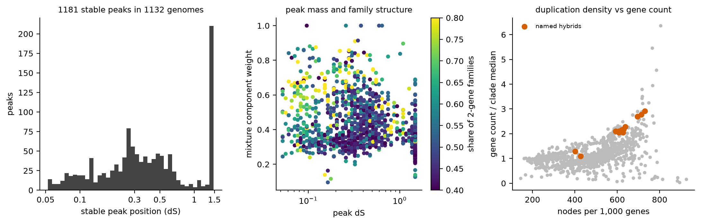

*Peak positions and masses of the stable catalogue.*

## 5.1 Controls

| control_group | n | med_Z | med_H | med_Y | med_2gene | med_busco_dup | med_gene_ratio | frac_with_supported_peak |
|---|---|---|---|---|---|---|---|---|
| Mucorales WGD | 32 | 0.00894 | 0.0186 | 0.0623 | 0.518 | 12.2 | 1.03 | 0.25 |
| literature hybrid species (strain may be collapsed) | 12 | 0.00123 | 0.00381 | 0.0308 | 0.691 | 57.3 | 1.65 | 0.5 |
| named hybrid (' x ' in name) | 13 | 0.00263 | 0.00723 | 0.0311 | 0.674 | 61.7 | 2.11 | 0.923 |
| post-WGD Saccharomycetaceae | 53 | 0.0021 | 0.00769 | 0.0375 | 0.66 | 3.7 | 1.02 | 0.226 |
| pre-WGD Saccharomycetaceae | 64 | 0.00106 | 0.00226 | 0.0145 | 0.609 | 0.9 | 0.956 | 0.172 |

Named hybrids (' x ' in name) and literature hybrids are the positive controls for a mid-dS peak. Collapsed assemblies of hybrids show no peak.
Saccharomycetaceae and Mucorales are controls for old mass and 2-gene structure, not for a peak, because their WGD is older than the dS window.
Several named controls show sharp peaks near dS 0.2 to 0.3 or near 1.3 to 1.5 in the figure. A peak at about 1.3 to 1.5 lies near the yn00 saturation zone,
so its position is a lower bound on the true divergence.

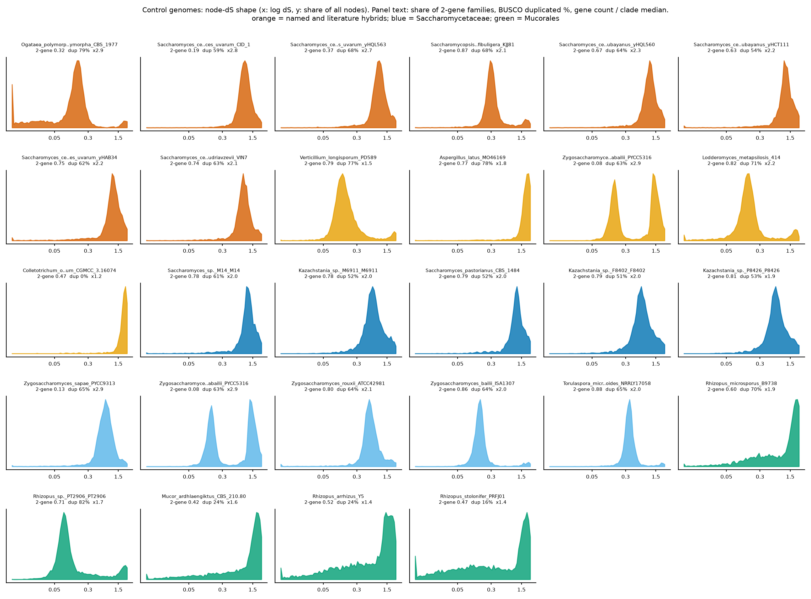

*Control genomes: node-dS shape.*

## 5.2 Interior peaks (centre <= 1.0) detected from histogram shape, cross-referenced with BUSCO

This screen uses the per-genome log-dS histogram directly (70 bins, 0.005 to 2.5), not the mixture model. A peak is a local maximum of the 3-bin smoothed density with
prominence >= 35% of its height, centre between 0.03 and 1.0, and at least 8% of the genome's tree nodes within its half-height width. Genomes need >= 300 tree nodes with dS > 0
(5,978 genomes evaluated). A peak is called *sharp* if the half-height width is <= 1.2 natural-log units (a 3.3-fold range of dS), the peak holds >= 40% of nodes, and prominence is >= 0.8.
Tiers: **A** sharp and BUSCO duplicated >= 40%; **B** sharp and 10-40%; **C** sharp and < 10%; **D** broad hump. BUSCO values are `duplicated_pct` from `tables/busco_genome.parquet` (fungi_odb12, joined by assembly ID).
Peaks above 1.0 are not called, so hybrids whose second peak lies near 1.5 (for example the older Zygosaccharomyces parabailii peak) show only their lower peak.

974 of 5,978 genomes have an interior peak <= 1.0 (944 with one peak, 30 with two or more). Tier counts: A sharp + BUSCO dup>=40%: 83; B sharp + BUSCO dup 10-40%: 24; C sharp + BUSCO dup<10%: 28; D broad hump: 839.

Share of genomes with an interior peak by BUSCO duplication:

| BUSCO dup bin | genomes | share_with_interior_peak |
|---|---|---|
| <1 | 4349 | 0.0963 |
| 1-5 | 962 | 0.263 |
| 5-10 | 227 | 0.238 |
| 10-20 | 162 | 0.364 |
| 20-40 | 115 | 0.539 |
| >=40 | 163 | 0.779 |

Tier A by phylum and class:

| phylum | cls | n_genomes_tier_A |
|---|---|---|
| Ascomycota | Saccharomycetes | 23 |
| Ascomycota | Pichiomycetes | 17 |
| Ascomycota | Sordariomycetes | 13 |
| Basidiomycota | Tremellomycetes | 9 |
| Ascomycota | Dothideomycetes | 8 |
| Basidiomycota | Agaricomycetes | 5 |
| Kickxellomycota | Dimargaritomycetes | 2 |
| Basidiomycota | Cystobasidiomycetes | 2 |
| Ascomycota | Ascomycota (unassigned) | 1 |
| Blastocladiomycota | Blastocladiomycetes | 1 |
| Entomophthoromycota | Entomophthoromycetes | 1 |
| Mucoromycota | Mucoromycetes | 1 |

Known and literature hybrids in this screen (n_peaks = 0 means no interior peak <= 1.0, either no peak or a peak above 1.0):

| genome | n_peaks | peak1_dS | peak1_mass | peak2_dS | peak2_mass | busco_dup | genes_ratio_clade |
|---|---|---|---|---|---|---|---|
| Aspergillus_latus_MO46169 | 0 |  |  |  |  | 77.5 | 1.76 |
| Cryptococcus_neoformans_x_Cryptococcus_deneoformans_CBS_132 | 1 | 0.31 | 0.666 |  |  | 19 | 1.1 |
| Ogataea_polymorpha_x_Ogataea_parapolymorpha_CBS_1977 | 1 | 0.167 | 0.551 |  |  | 78.6 | 2.92 |
| Saccharomyces_pastorianus_CBS_1484 | 0 |  |  |  |  | 51.8 | 2 |
| Verticillium_longisporum_PD589 | 1 | 0.14 | 0.714 |  |  | 77.2 | 1.54 |
| Zygosaccharomyces_bailii_ISA1307 | 1 | 0.167 | 0.779 |  |  | 64.1 | 1.97 |
| Zygosaccharomyces_mellis_6-7431 | 1 | 0.128 | 0.748 |  |  | 64.3 | 1.89 |
| Zygosaccharomyces_parabailii_PYCC5316 | 1 | 0.167 | 0.397 |  |  | 62.8 | 2.91 |
| Zygosaccharomyces_pseudobailii | 1 | 0.218 | 0.748 |  |  | 61.2 | 1.88 |
| Zygosaccharomyces_rouxii_ATCC42981 | 1 | 0.578 | 0.75 |  |  | 64.2 | 2.06 |
| Zygosaccharomyces_sapae_PYCC9313 | 1 | 0.754 | 0.789 |  |  | 64.8 | 2.89 |
| Zygosaccharomyces_siamensis_PYCC9244 | 1 | 0.754 | 0.767 |  |  | 63.6 | 1.89 |

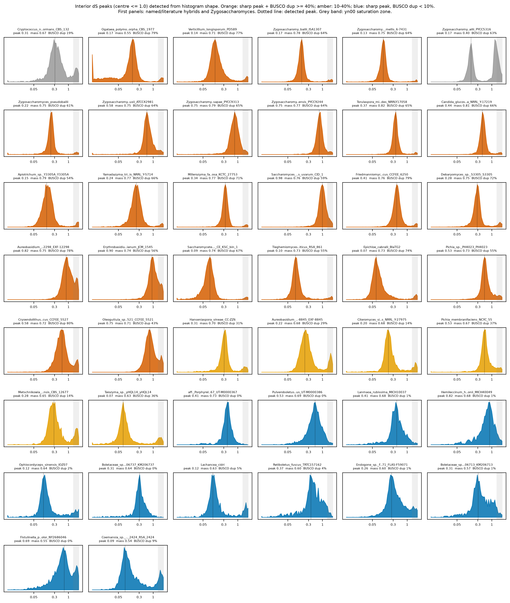

*Shape-detected interior peaks. Orange: tier A, amber: tier B, blue: tier C, grey: broad. Dotted line: detected peak.*

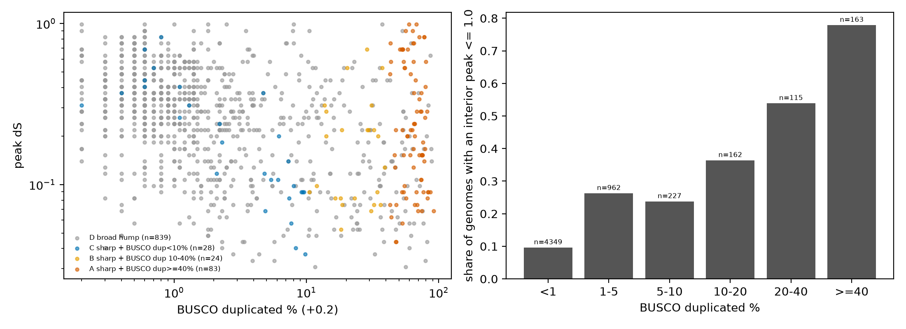

*Peak position against BUSCO duplication, and the share of genomes with an interior peak by BUSCO duplication.*

Reading the tiers. Tier A genomes combine a narrow dS peak with a high BUSCO duplicated fraction. The named and literature hybrids sit here
(Verticillium longisporum, Ogataea polymorpha x parapolymorpha, several Zygosaccharomyces). This is consistent with an assembly that carries two diverged genomes,
but dS and BUSCO together do not prove it. Gene count against the clade median, synteny and read data are the next checks (Section 10).
Tier C genomes have a sharp peak but little BUSCO duplication. Some have gene counts far below the clade median (for example several Boletaceae with gene-count ratios of 0.1 to 0.5).
That can mean partial annotation or a partial duplication, not a whole-genome event. Tier C is a list to inspect with FCS-GX and coverage data, not a list of events.
The yeast peaks near dS 0.5 to 1.0 lie where yn00 reads low relative to codeml, so true parental divergence there is likely higher than the peak position.

# 6. Assembly covariates and confounding

Fixed effects (contig count, size, GC, gene count, BUSCO duplication, TE per 1,000 genes) are in `tables/varcomp_fixed.tsv`. Compare the 'no covariates' and 'with covariates' rows in Section 3 to see how much clade variance is attributable to assembly properties. Where the clade share changes after adjustment, clade differences are not separable from assembly differences with these data.

# 7. Sensitivity to the codon gate (30 vs 100 codons)

| bin | genomes | median_share_30codons | median_share_100codons | spearman | median_abs_diff |
|---|---|---|---|---|---|
| Z | 7235 | 0.00222 | 0.00139 | 0.964 | 0.000279 |
| H | 7235 | 0.00885 | 0.00749 | 0.981 | 0.000825 |
| Y | 7235 | 0.0645 | 0.0569 | 0.991 | 0.00369 |
| MID | 7235 | 0.216 | 0.203 | 0.995 | 0.00978 |
| OLD | 7235 | 0.647 | 0.668 | 0.997 | 0.0121 |

`spearman` is the rank correlation of per-genome bin shares between the two gates.

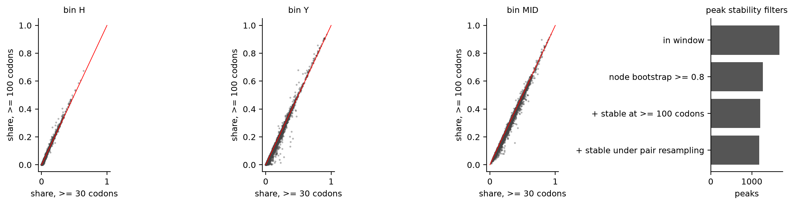

*Bin shares at 30 vs 100 codons.*

# 8. yn00 compared with codeml (300 wave-1 genomes)

| yn00_dS_bin | n_nodes | median_yn00 | median_codeml | median_ratio_codeml_over_yn00 | ratio_p10 | ratio_p90 | share_within_20pct | pearson |
|---|---|---|---|---|---|---|---|---|
| (-0.001, 1e-09] | 21088 | 0 | 0 |  |  |  | 0 |  |
| (1e-09, 0.02] | 61297 | 0.00917 | 0.009 | 0.975 | 0.847 | 1.19 | 0.901 | 0.432 |
| (0.02, 0.05] | 69661 | 0.0347 | 0.0352 | 1.02 | 0.889 | 1.13 | 0.957 | 0.783 |
| (0.05, 0.1] | 108321 | 0.0743 | 0.0769 | 1.04 | 0.945 | 1.13 | 0.974 | 0.769 |
| (0.1, 0.2] | 171826 | 0.146 | 0.154 | 1.06 | 0.98 | 1.16 | 0.969 | 0.828 |
| (0.2, 0.3] | 124735 | 0.246 | 0.268 | 1.08 | 0.995 | 1.22 | 0.92 | 0.601 |
| (0.3, 0.5] | 165601 | 0.388 | 0.435 | 1.11 | 0.996 | 1.35 | 0.807 | 0.575 |
| (0.5, 0.8] | 143703 | 0.629 | 0.718 | 1.13 | 0.95 | 1.54 | 0.673 | 0.445 |
| (0.8, 1.2] | 111139 | 0.977 | 1.09 | 1.11 | 0.835 | 1.57 | 0.612 | 0.34 |
| (1.2, 1.6] | 89820 | 1.39 | 1.55 | 1.12 | 0.789 | 1.49 | 0.567 | 0.273 |
| (1.6, 2.0] | 52975 | 1.76 | 1.9 | 1.07 | 0.756 | 1.32 | 0.673 | 0.157 |
| (2.0, 3.0] | 14218 | 2.14 | 2.02 | 0.932 | 0.628 | 1.13 | 0.708 | -0.0507 |

Genomes compared: 300. Median per-genome ratio (codeml / yn00): 1.009.

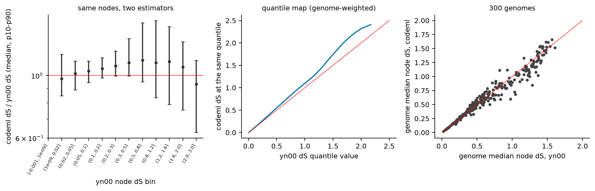

*yn00 against codeml node dS.*

The ratio table shows the dS range where the two estimators agree and where they separate. Above about 0.5 the median codeml/yn00 ratio grows and
the within-20% share falls. The 1.5 limit is stated as a measured property of this pipeline, not a general property of yn00.
A codeml second pass for yn00 dS 0.5 to 1.6 is planned as a calibration subset.

# 9. Example genomes

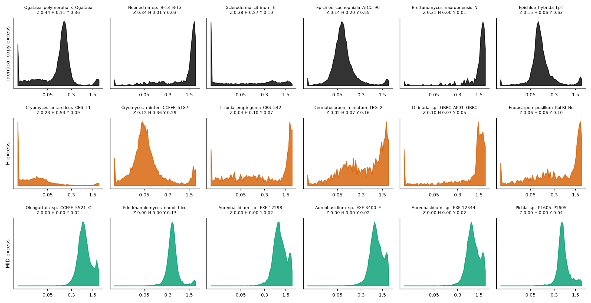

*Example genomes for identical-excess, H-excess and MID-excess flags.*

# 10. Follow-up tests for flagged genomes

1. BUSCO duplicated fraction and gene count against clade median (already in the tables).
2. Pfam domains of genes in identical groups (RVT_1, rve, DDE_Tnp, Chromo, gag). Report identical-group genes per 1,000 after removing TE-domain genes.
3. Contig-level checks: identical contigs, coverage bimodality, k-mer spectrum (heterozygous peak).
4. FCS-GX contig taxonomy for partial-genome peaks (possible contamination).
5. Synteny (wgd syn or i-ADHoRe) for any genome-scale claim. Do not use dS alone.
6. GFF coordinate overlap for annotation duplicates.

# 11. Literature context

Citations below were checked in PubMed on 2026-11-06 (see `fable_context.md` for DOIs and PMIDs).

- Yeast WGD: Wolfe and Shields 1997 (Nature); Kellis et al. 2004 (Nature); Marcet-Houben and Gabaldon 2015 (PLoS Biol), which proposes interspecies hybridisation as the origin.
- Mucorales: Ma et al. 2009 (PLoS Genet, Rhizopus delemar); Corrochano et al. 2016 (Curr Biol, Phycomyces and Mucor).
- Hybrids: Nakao et al. 2009 and Libkind et al. 2011 (S. pastorianus); Gallone et al. 2019 (beer hybrids); Ortiz-Merino et al. 2017 (Z. parabailii);
  Pryszcz et al. 2014 (C. orthopsilosis); Mixao and Gabaldon 2018 (review); Steenwyk et al. 2020 (A. latus); Fogelqvist et al. 2018 (V. longisporum);
  Lin et al. 2007 and Samarasinghe and Xu 2018 (Cryptococcus hybrids).
- Dikaryon and heterokaryon assemblies: Li et al. 2019 (Puccinia graminis haplotypes); Ropars et al. 2016, Chen et al. 2018 and Sperschneider et al. 2023 (AMF nuclei).
- TE-rich lineages: Duplessis et al. 2011 (rusts); Spanu et al. 2010 and Frantzeskakis et al. 2018 (Blumeria); Sipos et al. 2017 (Armillaria);
  Martin et al. 2010 (Tuber); Tisserant et al. 2013 (Rhizophagus); Goodwin et al. 2011 (Zymoseptoria).
- RIP: Galagan and Selker 2004 (Trends Genet).
- Assembly and Ks methods: Roach et al. 2018 (Purge Haplotigs); Steinegger and Salzberg 2020; Astashyn et al. 2024 (FCS-GX);
  Vanneste et al. 2013; Tiley et al. 2018; Zwaenepoel and Van de Peer 2019 (two papers); Chen et al. 2024 (wgd v2); Yang and Nielsen 2000 (yn00).

Statements marked unverified in `fable_context.md` are not used here.

# 12. Gene-level queries: young paralogs and shared domains

Query design. Genes are those in the gated sampled pairs of `wgd.ks.parquet` (identical-CDS groups contribute one representative). Each gene is assigned the minimum dS over the sampled pairs it appears in,
so a gene with several partners is placed in its youngest bin. Bins: Z (dS = 0), H1 (0, 0.1], Y (0.1, 0.3], MID (0.3, 1.5], OLD (> 1.5). *Recent* means Z plus H1.
For each Pfam domain and each CAZy family, a Mantel-Haenszel odds ratio compares genes of the focal bin with all other paralog genes of the same genome and the same protein-length class
(five classes: <150, 150-250, 250-400, 400-700, >=700 aa). Genome and length class are the strata, so large genomes and short proteins do not drive the result.
For Pfam, only genes with at least one Pfam hit count in both groups, because the Pfam hit rate differs by bin (below). Variance is Robins-Breslow-Greenland; q is Benjamini-Hochberg across domains.
A domain needs >= 20 genomes and >= 30 focal genes. Sets: all genomes, a *clean* set (BUSCO duplicated < 20%, gene count < 1.5x clade median, no named hybrid, not in shape tiers A or B), and clean Ascomycota and Basidiomycota separately.
Two checks changed the first version of this test: strata with the domain only in the reference group must be kept, and the length strata were added after young genes proved shorter. Results from the earlier, unstratified version are kept in `tables/gene_enrich_unstratified/` for comparison.

Share of paralog genes with at least one Pfam hit, by bin (all genomes):

| bin | n | frac_with_pfam |
|---|---|---|
| OLD | 6218262 | 0.831 |
| H1 | 3428502 | 0.511 |
| MID | 5403758 | 0.532 |
| Y | 3513173 | 0.491 |
| Z | 869298 | 0.459 |

Protein features of each bin against OLD (> 1.5) in the same genome, clean genomes, paired across genomes with >= 10 genes in both bins (Wilcoxon):

| bin | metric | n_genomes | median_B | median_OLD | median_diff | frac_genomes_higher | p_wilcoxon |
|---|---|---|---|---|---|---|---|
| Z | med_len | 2597 | 260 | 428 | -158 | 0.0774 | 0 |
| Z | frac_short150 | 2597 | 0.252 | 0.0569 | 0.184 | 0.933 | 0 |
| Z | frac_sigp | 2597 | 0.0328 | 0.109 | -0.0667 | 0.17 | 2.76e-232 |
| H1 | med_len | 4452 | 291 | 431 | -129 | 0.122 | 0 |
| H1 | frac_short150 | 4452 | 0.2 | 0.0549 | 0.13 | 0.917 | 0 |
| H1 | frac_sigp | 4452 | 0.0336 | 0.105 | -0.0639 | 0.166 | 0 |
| Y | med_len | 5188 | 291 | 433 | -137 | 0.0715 | 0 |
| Y | frac_short150 | 5188 | 0.215 | 0.0532 | 0.151 | 0.954 | 0 |
| Y | frac_sigp | 5188 | 0.0485 | 0.104 | -0.048 | 0.227 | 0 |
| MID | med_len | 6888 | 320 | 434 | -111 | 0.034 | 0 |
| MID | frac_short150 | 6888 | 0.177 | 0.051 | 0.12 | 0.983 | 0 |
| MID | frac_sigp | 6888 | 0.133 | 0.108 | 0.0218 | 0.64 | 1.49e-235 |

Young paralog genes are shorter and less often carry a signal peptide than OLD paralogs, in most genomes. Part of the length difference can arise from detection:
a short protein is less likely to keep an alignable, gated pair at high dS. The enrichment test therefore stratifies on length.

Number of domains enriched (q < 0.01, OR >= 2) by bin and set:

| bin | set | kind | genomes | domains_tested | enriched_q01_OR2 |
|---|---|---|---|---|---|
| recent (dS <= 0.1) | all | Pfam | 4195 | 5623 | 854 |
| recent (dS <= 0.1) | all | CAZy | 5233 | 146 | 2 |
| recent (dS <= 0.1) | clean | Pfam | 3768 | 4381 | 1227 |
| recent (dS <= 0.1) | clean | CAZy | 4788 | 112 | 3 |
| recent (dS <= 0.1) | clean_Ascomycota | Pfam | 2150 | 1389 | 456 |
| recent (dS <= 0.1) | clean_Ascomycota | CAZy | 3013 | 57 | 2 |
| recent (dS <= 0.1) | clean_Basidiomycota | Pfam | 1205 | 2755 | 431 |
| recent (dS <= 0.1) | clean_Basidiomycota | CAZy | 1304 | 80 | 1 |
| identical (dS = 0) | all | Pfam | 2162 | 3185 | 268 |
| identical (dS = 0) | all | CAZy | 3084 | 85 | 2 |
| identical (dS = 0) | clean | Pfam | 1834 | 1256 | 267 |
| identical (dS = 0) | clean | CAZy | 2706 | 51 | 1 |
| identical (dS = 0) | clean_Ascomycota | Pfam | 959 | 559 | 126 |
| identical (dS = 0) | clean_Ascomycota | CAZy | 1449 | 27 | 2 |
| identical (dS = 0) | clean_Basidiomycota | Pfam | 646 | 375 | 54 |
| identical (dS = 0) | clean_Basidiomycota | CAZy | 941 | 11 | 0 |
| Y (0.1-0.3) | all | Pfam | 4624 | 5483 | 165 |
| Y (0.1-0.3) | all | CAZy | 5582 | 143 | 1 |
| Y (0.1-0.3) | clean | Pfam | 4192 | 3649 | 290 |
| Y (0.1-0.3) | clean | CAZy | 5127 | 111 | 2 |
| Y (0.1-0.3) | clean_Ascomycota | Pfam | 2520 | 887 | 233 |
| Y (0.1-0.3) | clean_Ascomycota | CAZy | 3349 | 37 | 2 |
| Y (0.1-0.3) | clean_Basidiomycota | Pfam | 1239 | 2757 | 128 |
| Y (0.1-0.3) | clean_Basidiomycota | CAZy | 1305 | 85 | 0 |
| MID (0.3-1.5) | all | Pfam | 7274 | 6158 | 311 |
| MID (0.3-1.5) | all | CAZy | 7361 | 160 | 4 |
| MID (0.3-1.5) | clean | Pfam | 6814 | 4751 | 418 |
| MID (0.3-1.5) | clean | CAZy | 6899 | 149 | 3 |
| MID (0.3-1.5) | clean_Ascomycota | Pfam | 4936 | 2478 | 495 |
| MID (0.3-1.5) | clean_Ascomycota | CAZy | 4969 | 106 | 8 |
| MID (0.3-1.5) | clean_Basidiomycota | Pfam | 1433 | 3271 | 115 |
| MID (0.3-1.5) | clean_Basidiomycota | CAZy | 1452 | 112 | 1 |

Top Pfam domains for recent paralogs, clean genomes (>= 300 focal genes, sorted by odds ratio):

| dom | name | n_genomes | focal_genes | OR | ci_lo | ci_hi |
|---|---|---|---|---|---|---|
| PF:PF27657 | RRT15 | 138 | 481 | 22.7 | 17.1 | 30.3 |
| PF:PF07282 | Cas12f1-like_TNB | 123 | 1.81e+03 | 14.3 | 13.1 | 15.7 |
| PF:PF12511 | DUF3716 | 214 | 902 | 12.1 | 10.7 | 13.8 |
| PF:PF26935 | DUF8286 | 53 | 553 | 8.96 | 7.83 | 10.3 |
| PF:PF28402 | GloB_C | 124 | 364 | 8.25 | 7.02 | 9.7 |
| PF:PF12520 | DUF3723 | 266 | 964 | 7.75 | 7 | 8.58 |
| PF:PF13837 | Myb_DNA-bind_4 | 214 | 966 | 6.8 | 6.08 | 7.61 |
| PF:PF12013 | OrsD | 532 | 2.54e+03 | 6.79 | 6.37 | 7.25 |
| PF:PF23042 | KOW1_SPT5 | 246 | 1.56e+03 | 6.43 | 5.84 | 7.08 |
| PF:PF12776 | Myb_DNA-bind_3 | 429 | 2.62e+03 | 6.43 | 6 | 6.89 |
| PF:PF13966 | zf-RVT | 90 | 534 | 6.37 | 5.61 | 7.24 |
| PF:PF03439 | Spt5-NGN | 185 | 1.12e+03 | 6.32 | 5.67 | 7.06 |
| PF:PF29418 | DUF3723_N | 297 | 910 | 6.27 | 5.68 | 6.91 |
| PF:PF12851 | Tet_JBP | 231 | 1.41e+03 | 6.25 | 5.71 | 6.84 |
| PF:PF18721 | CxC6 | 204 | 1.73e+03 | 5.31 | 4.89 | 5.76 |
| PF:PF18718 | CxC5 | 227 | 1.96e+03 | 5.04 | 4.68 | 5.44 |
| PF:PF20499 | DUF6729 | 122 | 549 | 4.89 | 4.27 | 5.6 |
| PF:PF13352 | DUF4100 | 269 | 1.43e+03 | 4.8 | 4.41 | 5.22 |
| PF:PF24764 | rva_4 | 492 | 2.62e+03 | 4.75 | 4.48 | 5.05 |
| PF:PF27653 | SPOK2_N | 270 | 1.21e+03 | 4.48 | 4.13 | 4.87 |

Top Pfam domains for recent paralogs, clean Ascomycota:

| dom | name | n_genomes | focal_genes | OR | ci_lo | ci_hi |
|---|---|---|---|---|---|---|
| PF:PF24764 | rva_4 | 90 | 413 | 16.1 | 12.9 | 20 |
| PF:PF20149 | DUF6532 | 81 | 1.61e+03 | 15.3 | 13.5 | 17.2 |
| PF:PF18759 | Plavaka | 88 | 2.87e+03 | 14 | 12.8 | 15.2 |
| PF:PF12511 | DUF3716 | 214 | 902 | 12.1 | 10.7 | 13.8 |
| PF:PF12013 | OrsD | 287 | 1.71e+03 | 11.2 | 10.2 | 12.2 |
| PF:PF20231 | DUF6589 | 67 | 337 | 9.85 | 7.93 | 12.2 |
| PF:PF29418 | DUF3723_N | 245 | 825 | 8.58 | 7.67 | 9.59 |
| PF:PF28402 | GloB_C | 120 | 359 | 8.16 | 6.93 | 9.6 |
| PF:PF12520 | DUF3723 | 264 | 959 | 7.72 | 6.98 | 8.55 |
| PF:PF02902 | Peptidase_C48 | 135 | 322 | 5.91 | 4.98 | 7.03 |
| PF:PF05699 | Dimer_Tnp_hAT | 158 | 738 | 5.45 | 4.83 | 6.15 |
| PF:PF22594 | GTP-eEF1A_C | 208 | 441 | 5.11 | 4.42 | 5.9 |
| PF:PF03143 | GTP_EFTU_D3 | 218 | 457 | 4.89 | 4.25 | 5.63 |
| PF:PF27653 | SPOK2_N | 270 | 1.21e+03 | 4.48 | 4.13 | 4.87 |
| PF:PF11917 | DUF3435 | 400 | 1.62e+03 | 4.24 | 3.96 | 4.54 |

Top Pfam domains for recent paralogs, clean Basidiomycota:

| dom | name | n_genomes | focal_genes | OR | ci_lo | ci_hi |
|---|---|---|---|---|---|---|
| PF:PF13837 | Myb_DNA-bind_4 | 171 | 629 | 7.24 | 6.24 | 8.4 |
| PF:PF12776 | Myb_DNA-bind_3 | 365 | 2.28e+03 | 6.66 | 6.17 | 7.18 |
| PF:PF12851 | Tet_JBP | 212 | 1.35e+03 | 6.48 | 5.9 | 7.11 |
| PF:PF23042 | KOW1_SPT5 | 219 | 1.51e+03 | 6.44 | 5.85 | 7.09 |
| PF:PF03439 | Spt5-NGN | 157 | 1.06e+03 | 6.32 | 5.66 | 7.07 |
| PF:PF18721 | CxC6 | 203 | 1.73e+03 | 5.31 | 4.89 | 5.77 |
| PF:PF18718 | CxC5 | 227 | 1.96e+03 | 5.04 | 4.68 | 5.44 |
| PF:PF02338 | OTU | 54 | 339 | 4.96 | 4.08 | 6.03 |
| PF:PF13352 | DUF4100 | 266 | 1.42e+03 | 4.77 | 4.39 | 5.19 |
| PF:PF18803 | CxC2 | 492 | 6.66e+03 | 4.32 | 4.15 | 4.49 |
| PF:PF28437 | DUF8397 | 106 | 587 | 4.29 | 3.76 | 4.89 |
| PF:PF26792 | DUF8263 | 176 | 1.01e+03 | 4.28 | 3.88 | 4.71 |
| PF:PF10551 | MULE | 116 | 323 | 4.27 | 3.6 | 5.06 |
| PF:PF20681 | DUF6818 | 125 | 370 | 4.22 | 3.6 | 4.94 |
| PF:PF24764 | rva_4 | 393 | 2.17e+03 | 4.15 | 3.89 | 4.42 |

Top Pfam domains for identical-CDS genes, clean genomes:

| dom | name | n_genomes | focal_genes | OR | ci_lo | ci_hi |
|---|---|---|---|---|---|---|
| PF:PF27657 | RRT15 | 92 | 314 | 22.2 | 17.3 | 28.6 |
| PF:PF12511 | DUF3716 | 85 | 358 | 5.84 | 5.01 | 6.82 |
| PF:PF12013 | OrsD | 165 | 711 | 5.3 | 4.81 | 5.83 |
| PF:PF18718 | CxC5 | 74 | 466 | 4.1 | 3.67 | 4.57 |
| PF:PF18721 | CxC6 | 66 | 414 | 4 | 3.56 | 4.5 |
| PF:PF12851 | Tet_JBP | 70 | 276 | 3.87 | 3.37 | 4.45 |
| PF:PF24764 | rva_4 | 166 | 572 | 3.78 | 3.44 | 4.16 |
| PF:PF01693 | Cauli_VI | 128 | 527 | 3.51 | 3.18 | 3.88 |
| PF:PF23042 | KOW1_SPT5 | 69 | 271 | 3.4 | 2.95 | 3.9 |
| PF:PF20414 | DUF6698 | 200 | 1.32e+03 | 3.2 | 3 | 3.4 |
| PF:PF01399 | PCI | 121 | 284 | 3.05 | 2.61 | 3.56 |
| PF:PF02902 | Peptidase_C48 | 131 | 446 | 2.97 | 2.66 | 3.31 |
| PF:PF00867 | XPG_I | 98 | 269 | 2.88 | 2.51 | 3.3 |
| PF:PF18803 | CxC2 | 187 | 1.05e+03 | 2.7 | 2.52 | 2.89 |
| PF:PF20231 | DUF6589 | 149 | 558 | 2.47 | 2.26 | 2.71 |

Top Pfam domains for Y-bin genes (0.1-0.3), clean genomes:

| dom | name | n_genomes | focal_genes | OR | ci_lo | ci_hi |
|---|---|---|---|---|---|---|
| PF:PF08071 | RS4NT | 235 | 432 | 5.75 | 5.07 | 6.51 |
| PF:PF00181 | Ribosomal_L2_N | 335 | 638 | 5.69 | 5.1 | 6.34 |
| PF:PF03947 | Ribosomal_L2_C | 322 | 622 | 5.58 | 5 | 6.22 |
| PF:PF16121 | 40S_S4_C | 237 | 437 | 5.48 | 4.84 | 6.2 |
| PF:PF00900 | Ribosomal_S4e | 235 | 429 | 5.44 | 4.8 | 6.16 |
| PF:PF11917 | DUF3435 | 535 | 1.62e+03 | 5.22 | 4.9 | 5.56 |
| PF:PF26935 | DUF8286 | 74 | 455 | 5.05 | 4.42 | 5.77 |
| PF:PF23948 | ARM_5 | 48 | 1.34e+03 | 5.03 | 4.63 | 5.46 |
| PF:PF12520 | DUF3723 | 236 | 553 | 4.77 | 4.31 | 5.28 |
| PF:PF00805 | Pentapeptide | 56 | 1.24e+03 | 4.67 | 4.28 | 5.09 |
| PF:PF01015 | Ribosomal_S3Ae | 149 | 334 | 4.18 | 3.67 | 4.77 |
| PF:PF01479 | S4 | 369 | 722 | 4.01 | 3.65 | 4.41 |
| PF:PF15715 | PAF | 361 | 718 | 3.92 | 3.53 | 4.37 |
| PF:PF01157 | Ribosomal_L21e | 167 | 310 | 3.9 | 3.36 | 4.53 |
| PF:PF00416 | Ribosomal_S13 | 155 | 314 | 3.84 | 3.3 | 4.46 |

CAZy families enriched among recent paralogs, clean genomes (>= 30 focal genes):

| dom | name | n_genomes | focal_genes | OR | ci_lo | ci_hi |
|---|---|---|---|---|---|---|
| CAZy:GT59 |  | 22 | 38 | 2.95 | 1.72 | 5.07 |
| CAZy:GT33 |  | 29 | 51 | 2.32 | 1.57 | 3.41 |
| CAZy:GT76 |  | 38 | 78 | 2.28 | 1.63 | 3.18 |

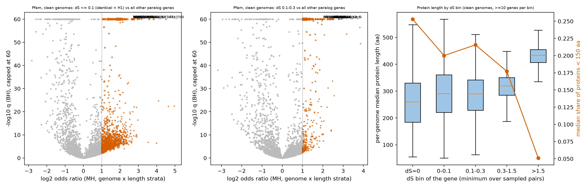

*Pfam enrichment volcano plots (clean genomes) and protein length by dS bin.*

Interpretation, with limits.

- Domain names are those in the Pfam table. Many top domains are named for transposases, integrases or retroelement proteins
  (for example Plavaka, KDZ, CxC, Tet_JBP, MULE, Transposase_21, rva_4, zf-RVT, Myb_DNA-bind_3 and _4, Cas12f1-like_TNB). I did not check each family description here. By name, this set points to transposon-derived gene models among recent duplicates.
  This matches the TE-like identical-copy profile in Section 4.
- SPOK2_N and OrsD (PF12013) are enriched among recent paralogs, mainly in Ascomycota. I did not verify what these families do. The OrsD gene set is examined in `reports/H3_OrsD_case_study.md`.
- Y-bin genes are enriched for ribosomal-protein and translation-factor domains (L2, S4, S6e, L21e). Ribosomal-protein families are small and often multicopy, so duplicated models or processed copies are plausible. This is not tested here.
- Several domains are of unknown function (DUF names, RRT15). They are reported as found and not interpreted.
- CAZy families show almost no enrichment in the recent bin after stratification. Recent duplication of CAZymes is not a general feature of these data.
- The dS bin is set by sampled pairs, not by all pairs of a gene, and each family contributes at most five pairs per node. Enrichment of a domain may partly reflect how families are sampled.
  The effect of this sampling on gene-level bins has not been measured.

# 13. Reproducibility

Scripts: `eval/explore/scripts/` (shape_peaks, shape_plots, gene_recent_enrich, gene_plots, gene_stats, taxonomy, build_features2, build_table, pfam_te_counts, build_hist, compare_codeml_yn00, stats, varcomp.R, plots, make_report).
Inputs: `paralogoscope_pilot/nf_full/tables_yn00` (interim, 7,384 genomes; to be replaced by the final tables when the last giant genome completes).
Report built 2026-11-07 09:55.
