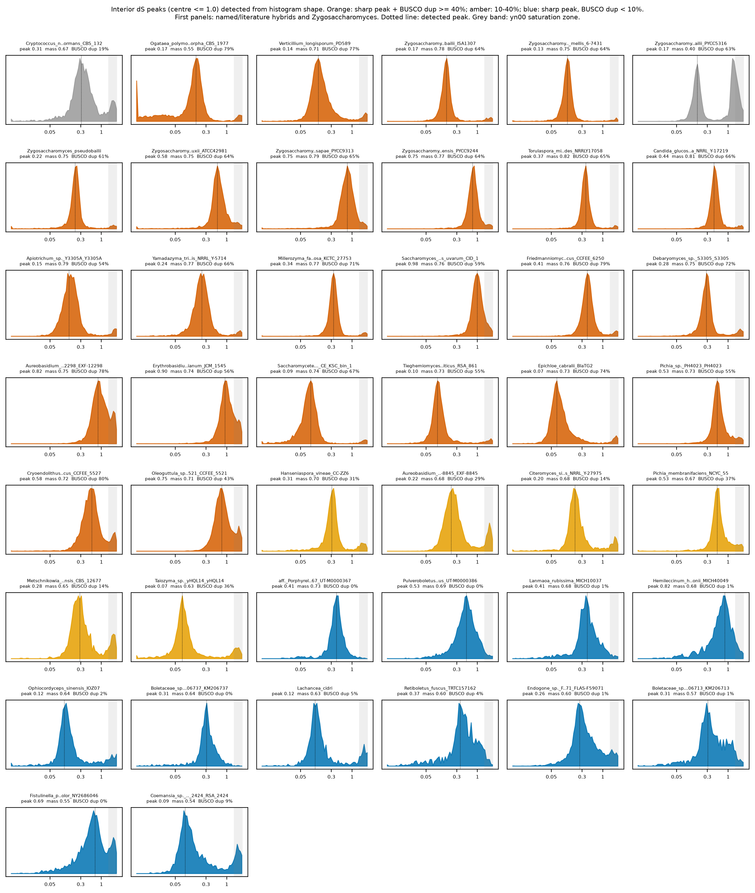
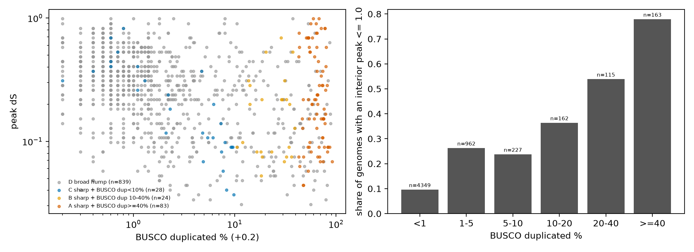

This report tests hypotheses about genomes whose node-dS histogram has a peak at dS <= 1.0. Method: `scripts/shape_peaks.py`. Statistics: `scripts/README.md`.

Status: interim. All numbers come from the 7,384-genome interim tables (yn00 dS). They will change when the final tables are published.

## H1.1 Interior peaks track assembly duplication

**Hypothesis.** Genomes with an interior peak carry two diverged genome copies in the assembly, so BUSCO duplicated % is higher in them.

**It would count against the hypothesis if:** the share of genomes with a peak does not rise with BUSCO duplication.

**Test.** Share of the 5,978 evaluated genomes with an interior peak by BUSCO duplicated-% bin; Spearman correlation between BUSCO duplicated % and having a peak. Verdict rule: SUPPORTED if the top bin is more than 3 times the bottom bin and rho > 0.2.

**Result.** | b | genomes | share_with_peak |
|---|---|---|
| <1 | 4349 | 0.0963 |
| 1-5 | 962 | 0.263 |
| 5-10 | 227 | 0.238 |
| 10-20 | 162 | 0.364 |
| 20-40 | 115 | 0.539 |
| >=40 | 163 | 0.779 |

Spearman rho = 0.28 (p = 3.2e-111).

**Verdict: SUPPORTED.** This shows association, not mechanism. High BUSCO duplication has several causes (hybrid, dikaryon, haplotig duplication, contamination). Peaks also occur in 10% of genomes with BUSCO duplication under 1%, so BUSCO duplication is not necessary.

## H1.2 The detector finds known hybrids and not old WGDs

**Hypothesis.** Named and literature hybrids (positive controls) usually show an interior peak. Old WGD clades (Saccharomycetaceae, Mucorales) do not, because their duplicates are older than the dS window.

**It would count against the hypothesis if:** most hybrid controls lack a peak, or old-WGD controls show peaks as often as hybrids.

**Test.** Detection rate of the shape screen in each control group. Verdict rule: SUPPORTED if hybrids are detected in >= 50% and the old-WGD rate is below half of that.

**Result.** | control_group | n | evaluated | with_interior_peak |
|---|---|---|---|
| Mucorales WGD | 32 | 32 | 5 |
| literature hybrid species (strain may be collapsed) | 12 | 10 | 5 |
| named hybrid (' x ' in name) | 13 | 13 | 8 |
| post-WGD Saccharomycetaceae | 53 | 35 | 9 |
| pre-WGD Saccharomycetaceae | 64 | 12 | 11 |

Hybrid controls with a peak: 0.57. Old-WGD controls with a peak: 0.32.

Named examples:

| genome | n_peaks | peak1_dS | peak1_mass | peak2_dS | busco_dup | genes_ratio_clade |
|---|---|---|---|---|---|---|
| Aspergillus_latus_MO46169 | 0 |  |  |  | 77.5 | 1.76 |
| Cryptococcus_neoformans_x_Cryptococcus_deneoformans_CBS_132 | 1 | 0.31 | 0.666 |  | 19 | 1.1 |
| Ogataea_polymorpha_x_Ogataea_parapolymorpha_CBS_1977 | 1 | 0.167 | 0.551 |  | 78.6 | 2.92 |
| Saccharomyces_pastorianus_CBS_1484 | 0 |  |  |  | 51.8 | 2 |
| Verticillium_longisporum_PD589 | 1 | 0.14 | 0.714 |  | 77.2 | 1.54 |
| Zygosaccharomyces_bailii_ISA1307 | 1 | 0.167 | 0.779 |  | 64.1 | 1.97 |
| Zygosaccharomyces_parabailii_PYCC5316 | 1 | 0.167 | 0.397 |  | 62.8 | 2.91 |

**Verdict: INCONCLUSIVE.** The old-WGD rate is not a clean false-positive rate. Only genomes with >= 300 nodes with dS > 0 are evaluated: 79 of 149 old-WGD controls pass, and the pre-WGD group keeps only 12 of 64. Pre-WGD genera such as Zygosaccharomyces and Torulaspora include hybrid strains, which are the genomes with enough paralog nodes to pass. The control set therefore mixes old-WGD and hybrid genomes. A control set that excludes known hybrid genera is needed for a real specificity estimate. Misses: *Aspergillus latus* and *S. pastorianus* have no peak at dS <= 1.0 because their peaks are above 1.0. *Z. parabailii* shows only its lower peak. The positive controls were also used to choose the thresholds, so the detection rate is optimistic.

## H1.3 Tier A peaks are whole-genome signals

**Hypothesis.** Genomes with a sharp peak and BUSCO duplication >= 40% (tier A) hold two genome copies, so they should also have about twice the clade-median gene count and a higher share of 2-gene families.

**It would count against the hypothesis if:** tier A gene counts are near the clade median.

**Test.** Median gene-count ratio and 2-gene-family share by tier, against genomes with no interior peak. Verdict rule: SUPPORTED if tier A median gene ratio >= 1.5 times that of no-peak genomes.

**Result.** | tier | genomes | med_gene_ratio | frac_ratio_ge_1_5 | med_2gene_share | med_busco_dup |
|---|---|---|---|---|---|
| A sharp + BUSCO dup>=40% | 83 | 1.87 | 0.88 | 0.828 | 64.8 |
| B sharp + BUSCO dup 10-40% | 24 | 1.59 | 0.542 | 0.737 | 25.7 |
| C sharp + BUSCO dup<10% | 28 | 1.04 | 0.0714 | 0.646 | 4.55 |
| D broad hump | 839 | 1.03 | 0.149 | 0.502 | 1.1 |

Genomes with no interior peak: median gene ratio 1.02, median 2-gene share 0.50. Tier A against no-peak, gene ratio: Mann-Whitney p = 3.1e-50.

**Verdict: SUPPORTED.** Gene counts above the clade median also arise from annotation differences. Synteny or read depth is needed for a genome-scale claim.

## H1.4 Sharp peaks without BUSCO duplication (tier C) are partial annotations or partial duplications

**Hypothesis.** Tier C genomes have more low gene counts than genomes without a peak, which restricts the paralog set and sharpens a small peak.

**It would count against the hypothesis if:** tier C low-gene-count share is similar to that of genomes without a peak.

**Test.** Share of tier C genomes (n = 28) with gene count below 0.7 times the clade median, against genomes with no interior peak. Verdict rule: PARTLY SUPPORTED if tier C share >= 25% and >= 2 times the no-peak share; NOT SUPPORTED otherwise.

**Result.** 0.32 of tier C genomes have a gene ratio below 0.7, against 0.02 of genomes with no interior peak. Median gene ratio is 1.04 in tier C and 1.02 in genomes without a peak. The majority of tier C genomes are therefore not low-gene-count.

| genome | cls | peak1_dS | peak1_mass | busco_dup | genes_ratio_clade | share_2gene_fam |
|---|---|---|---|---|---|---|
| aff._Porphyrellus_sp._UT-M0000367_UT-M0000367 | Agaricomycetes | 0.405 | 0.728 | 0.4 | 0.165 | 0.467 |
| Pulveroboletus_aff._annulatus_UT-M0000386 | Agaricomycetes | 0.529 | 0.686 | 0.5 | 0.529 | 0.482 |
| Lanmaoa_rubissima_MICH10037 | Agaricomycetes | 0.405 | 0.684 | 0.9 | 0.417 | 0.71 |
| Hemileccinum_hortonii_MICH40049 | Agaricomycetes | 0.824 | 0.678 | 0.6 | 0.461 | 0.635 |
| Ophiocordyceps_sinensis_IOZ07 | Sordariomycetes | 0.117 | 0.641 | 1.9 | 0.999 | 0.546 |
| Boletaceae_sp._KM206737_KM206737 | Agaricomycetes | 0.31 | 0.639 | 0 | 0.0926 | 0.3 |
| Lachancea_cidri | Saccharomycetes | 0.117 | 0.63 | 4.6 | 1.16 | 0.74 |
| Retiboletus_fuscus_TRTC157162 | Agaricomycetes | 0.371 | 0.603 | 4.5 | 0.166 | 0.554 |
| Endogone_sp._FLAS-F59071_FLAS-F59071 | Endogonomycetes | 0.26 | 0.599 | 0.9 | 1.16 | 0.538 |
| Boletaceae_sp._KM206713_KM206713 | Agaricomycetes | 0.31 | 0.568 | 1.1 | 0.168 | 0.581 |
| Fistulinella_prunicolor_NY2686046 | Agaricomycetes | 0.69 | 0.552 | 0.4 | 1.02 | 0.442 |
| Coemansia_sp._RSA_2424_RSA_2424 | Kickxellomycetes | 0.0895 | 0.544 | 9.4 | 1.45 | 0.742 |

**Verdict: PARTLY SUPPORTED.** A low gene ratio shows a small gene set but not the cause. For most tier C genomes the explanation is not found here; they need FCS-GX, coverage and synteny.

## H1.5 Peaks at low dS are heterozygosity (haplotype) signals, and peaks at higher dS are hybrid divergence

**Hypothesis.** Tier A peaks are spread between heterozygosity-level dS (<= 0.1) and hybrid-level dS, and low-dS peaks are common in dikaryotic or heterokaryotic groups.

**It would count against the hypothesis if:** all tier A peaks sit at one dS.

**Test.** Distribution of tier A peak positions by phylum.

**Result.** | phylum | n | med_peak_dS | frac_peak_le_0_1 |
|---|---|---|---|
| Ascomycota | 62 | 0.228 | 0.29 |
| Basidiomycota | 16 | 0.153 | 0 |
| Blastocladiomycota | 1 | 0.578 | 0 |
| Entomophthoromycota | 1 | 0.199 | 0 |
| Kickxellomycota | 2 | 0.0777 | 1 |
| Mucoromycota | 1 | 0.0819 | 1 |

0.25 of tier A peaks are at dS <= 0.1 (n = 83).

**Verdict: INCONCLUSIVE.** dS position alone does not tell heterozygosity from hybrid divergence. Both occur in tier A. A distinction needs the parent genomes' ortholog dS or phased assemblies. Positions near 0.5 to 1.0 are lower bounds because yn00 reads low there.

## Figures

## Reproduce

`scripts/shape_peaks.py`, `scripts/shape_plots.py`, `scripts/make_hypothesis_reports.py`. Thresholds were set by inspecting positive controls and have not been validated on held-out data.
