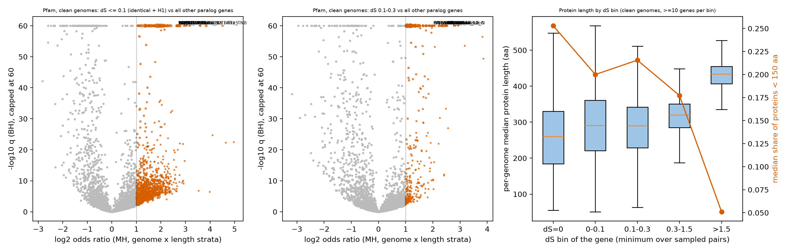

Genes in the youngest dS bins (dS <= 0.1, 'recent') are compared with other paralog genes of the same genome and protein-length class. Method and statistics: `scripts/gene_recent_enrich.py` and `scripts/README.md`.

Status: interim. All numbers come from the 7,384-genome interim tables (yn00 dS). They will change when the final tables are published.

## H2.1 Recent duplicates are enriched for transposon-derived genes

**Hypothesis.** Pfam domains named for transposases, integrases or retroelement proteins are over-represented among recent paralogs.

**It would count against the hypothesis if:** fewer than 40% of the top enriched domains have transposon-related names.

**Test.** Among the 40 highest-odds-ratio domains in the clean genome set (q < 0.01, odds ratio >= 2, >= 300 focal genes), count those whose Pfam *name* matches a transposon-related pattern. The pattern is my choice. I wrote it after seeing the top-domain list, so it is post hoc and liberal (it also matches names such as Chromo, OTU and Peptidase_C48). The pattern is: `transpos|Tnp|RVT|^rve|rva|MULE|hAT|Dimer_Tnp|Myb_DNA-bind|CxC|KDZ|Plavaka|Tet_JBP|Cas12f1|gag|Retrotran|integrase|zf-RVT|DDE|Asp_protease|Transposase|Helitron|Chromo|DUF6532|DUF6698|DUF6830|FLYWCH|OTU|Peptidase_C48`. Matches are flagged in the table so the reader can audit them. Verdict rule: SUPPORTED if >= 40%.

**Result.** 19 of 40 (0.47) match.

| dom | name | n_genomes | focal_genes | OR | ci_lo | ci_hi | te_name_match |
|---|---|---|---|---|---|---|---|
| PF:PF27657 | RRT15 | 138 | 481 | 22.7 | 17.1 | 30.3 | False |
| PF:PF07282 | Cas12f1-like_TNB | 123 | 1.81e+03 | 14.3 | 13.1 | 15.7 | True |
| PF:PF12511 | DUF3716 | 214 | 902 | 12.1 | 10.7 | 13.8 | False |
| PF:PF26935 | DUF8286 | 53 | 553 | 8.96 | 7.83 | 10.3 | False |
| PF:PF28402 | GloB_C | 124 | 364 | 8.25 | 7.02 | 9.7 | False |
| PF:PF12520 | DUF3723 | 266 | 964 | 7.75 | 7 | 8.58 | False |
| PF:PF13837 | Myb_DNA-bind_4 | 214 | 966 | 6.8 | 6.08 | 7.61 | True |
| PF:PF12013 | OrsD | 532 | 2.54e+03 | 6.79 | 6.37 | 7.25 | False |
| PF:PF23042 | KOW1_SPT5 | 246 | 1.56e+03 | 6.43 | 5.84 | 7.08 | False |
| PF:PF12776 | Myb_DNA-bind_3 | 429 | 2.62e+03 | 6.43 | 6 | 6.89 | True |
| PF:PF13966 | zf-RVT | 90 | 534 | 6.37 | 5.61 | 7.24 | True |
| PF:PF03439 | Spt5-NGN | 185 | 1.12e+03 | 6.32 | 5.67 | 7.06 | False |
| PF:PF29418 | DUF3723_N | 297 | 910 | 6.27 | 5.68 | 6.91 | False |
| PF:PF12851 | Tet_JBP | 231 | 1.41e+03 | 6.25 | 5.71 | 6.84 | True |
| PF:PF18721 | CxC6 | 204 | 1.73e+03 | 5.31 | 4.89 | 5.76 | True |
| PF:PF18718 | CxC5 | 227 | 1.96e+03 | 5.04 | 4.68 | 5.44 | True |
| PF:PF20499 | DUF6729 | 122 | 549 | 4.89 | 4.27 | 5.6 | False |
| PF:PF13352 | DUF4100 | 269 | 1.43e+03 | 4.8 | 4.41 | 5.22 | False |
| PF:PF24764 | rva_4 | 492 | 2.62e+03 | 4.75 | 4.48 | 5.05 | True |
| PF:PF27653 | SPOK2_N | 270 | 1.21e+03 | 4.48 | 4.13 | 4.87 | False |
| PF:PF02992 | Transposase_21 | 149 | 527 | 4.45 | 3.91 | 5.06 | True |
| PF:PF26792 | DUF8263 | 179 | 1.05e+03 | 4.44 | 4.03 | 4.88 | False |
| PF:PF02338 | OTU | 78 | 389 | 4.42 | 3.7 | 5.28 | True |
| PF:PF20681 | DUF6818 | 135 | 409 | 4.37 | 3.76 | 5.09 | False |
| PF:PF18803 | CxC2 | 504 | 6.72e+03 | 4.33 | 4.17 | 4.51 | True |
| PF:PF28437 | DUF8397 | 106 | 587 | 4.29 | 3.76 | 4.89 | False |
| PF:PF04434 | SWIM | 122 | 374 | 4.07 | 3.49 | 4.74 | False |
| PF:PF18758 | KDZ | 725 | 1.3e+04 | 4.05 | 3.94 | 4.16 | True |
| PF:PF13359 | DDE_Tnp_4 | 267 | 983 | 4.05 | 3.68 | 4.45 | True |
| PF:PF11917 | DUF3435 | 425 | 1.67e+03 | 4.01 | 3.75 | 4.28 | False |
| PF:PF18717 | CxC4 | 92 | 542 | 3.85 | 3.38 | 4.39 | True |
| PF:PF18802 | CxC1 | 313 | 1.76e+03 | 3.8 | 3.53 | 4.09 | True |
| PF:PF18759 | Plavaka | 899 | 2.47e+04 | 3.73 | 3.65 | 3.8 | True |
| PF:PF10551 | MULE | 219 | 1.2e+03 | 3.72 | 3.4 | 4.08 | True |
| PF:PF20149 | DUF6532 | 714 | 1.08e+04 | 3.51 | 3.42 | 3.62 | True |
| PF:PF02902 | Peptidase_C48 | 498 | 2.17e+03 | 3.37 | 3.16 | 3.59 | True |
| PF:PF22594 | GTP-eEF1A_C | 353 | 827 | 3.33 | 3.03 | 3.66 | False |
| PF:PF03143 | GTP_EFTU_D3 | 373 | 866 | 3.28 | 2.99 | 3.59 | False |
| PF:PF29850 | DUF8590 | 311 | 1.49e+03 | 3.23 | 2.99 | 3.5 | False |
| PF:PF01612 | DNA_pol_A_exo1 | 271 | 938 | 3.18 | 2.91 | 3.49 | False |

**Verdict: PARTLY SUPPORTED (by domain name only, post hoc pattern).** This rests on domain names, which I did not check against Pfam family descriptions. Several top domains are of unknown function. A direct TE test for one family (OrsD, report H3) found no proximity to TE-domain genes.

## H2.2 Young paralog genes are shorter and less often secreted

**Hypothesis.** Recent paralogs include short gene models (fragments, small ORFs), so their median protein length is lower than that of old paralogs and fewer have a signal peptide.

**It would count against the hypothesis if:** median lengths are equal or higher in the young bins.

**Test.** Per-genome median protein length of each bin against the OLD (dS > 1.5) bin in the same genome, clean genomes, genomes with >= 10 genes in both bins. Verdict rule: SUPPORTED if the H1 bin median is lower and fewer than 20% of genomes show higher length.

**Result.** | bin | n_genomes | median_B | median_OLD | frac_genomes_higher | sigp_B | sigp_OLD | sigp_frac_higher |
|---|---|---|---|---|---|---|---|
| Z | 2597 | 260 | 428 | 0.0774 | 0.0328 | 0.109 | 0.17 |
| H1 | 4452 | 291 | 431 | 0.122 | 0.0336 | 0.105 | 0.166 |
| Y | 5188 | 291 | 433 | 0.0715 | 0.0485 | 0.104 | 0.227 |
| MID | 6888 | 320 | 434 | 0.034 | 0.133 | 0.108 | 0.64 |

**Verdict: SUPPORTED.** Part of the effect can be a detection artefact: short proteins less often keep an alignable gated pair at high dS. The enrichment tests in H2.1 stratify on length for that reason, but the length effect itself is not separated from detection here. The OrsD family is an exception (long proteins, report H3).

## H2.3 Recent duplication is concentrated in carbohydrate-active enzyme families

**Hypothesis.** CAZy families are enriched among recent paralogs.

**It would count against the hypothesis if:** few or no CAZy families pass q < 0.01 and OR >= 2.

**Test.** Same test as Pfam, on CAZy family labels (subfamily suffix removed). Verdict rule: NOT SUPPORTED if at most 5 families pass in any set.

**Result.** | bin | set | families_tested | enriched | top |
|---|---|---|---|---|
| recent | all | 146 | 2 | GT59, GH64 |
| recent | clean | 112 | 3 | GT59, GT33, GT76 |
| recent | clean_Ascomycota | 57 | 2 | CBM21, GT4 |
| recent | clean_Basidiomycota | 80 | 1 | GT3 |
| identical | all | 85 | 2 | GT21, CE9 |
| identical | clean | 51 | 1 | GT4 |
| identical | clean_Ascomycota | 27 | 2 | GH2, GH128 |
| identical | clean_Basidiomycota | 11 | 0 |  |

**Verdict: NOT SUPPORTED.** CAZy labels are coarse. A gene's bin depends on sampled pairs. The result applies to the whole-set level, not to individual genomes or lifestyles.

## H2.4 The enrichments are robust to clade, protein length and assembly quality

**Hypothesis.** A real property of young paralogs should hold in both large phyla, with and without length strata, and with or without assembly-suspect genomes.

**It would count against the hypothesis if:** domain log odds ratios are uncorrelated between Ascomycota and Basidiomycota, or change strongly with length strata or genome filtering.

**Test.** Spearman correlation of log odds ratios between sets, for domains tested in both. Verdict rule: SUPPORTED if rho > 0.3 between phyla and > 0.7 for the length and genome-filter comparisons.

**Result.** | comparison | domains | spearman_lnOR | shared_enriched | only_A | only_B |
|---|---|---|---|---|---|
| Ascomycota vs Basidiomycota (clean), domains tested in both | 1194 | 0.65 | 63 | 393 | 368 |
| length-stratified vs unstratified (clean) | 4381 | 0.992 | 1183 | 44 | 106 |
| clean vs all genomes | 4381 | 0.887 | 491 | 736 | 363 |

**Verdict: SUPPORTED.** Correlation says the ranking is stable, not that each domain is a true biological signal. The first version of this test (strata dropped when the domain was absent from the focal group) inflated nearly all odds ratios; that error was found by checking that 88% of domains passing was implausible.

## Figure

## Reproduce

`scripts/gene_recent_enrich.py`, `scripts/gene_plots.py`, `scripts/make_hypothesis_reports.py`.
