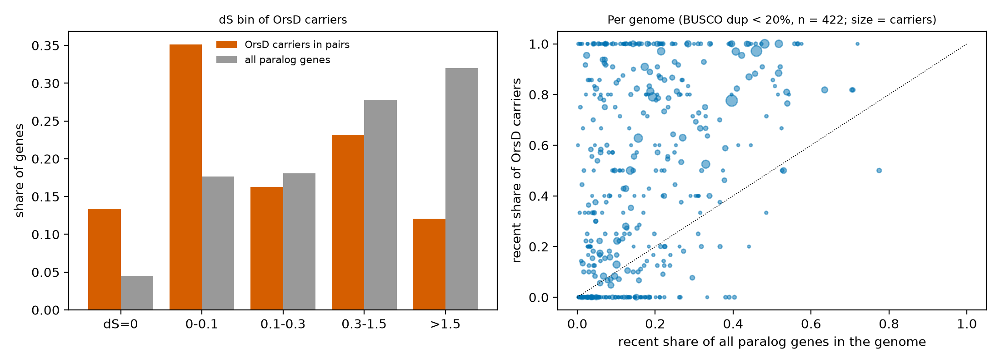

OrsD is the Pfam name in the database. Its function and family description were not verified (a web search returned no entry). This report tests what the data show about the gene set. Method: `scripts/domain_geneset.py`, `domain_te_context.py`, `domain_deepdive.py`.

Status: interim. All numbers come from the 7,384-genome interim tables (yn00 dS). They will change when the final tables are published.

**Starting observation.** Among carriers of PF12013 that sit in a gated pair, 48.5% are at dS <= 0.1. Among all paralog genes the share is 22.1%. In the clean genome set the odds ratio against other paralogs is 6.8 (95% CI 6.4 to 7.2; length- and genome-stratified Mantel-Haenszel; `tables/gene_enrich_recent_pf_clean.tsv`). The gene set has 44,086 proteins, of which 37,234 are in no gated pair.

| bin | domain_genes | all_paralog_genes | share_domain_in_pairs | share_all |
|---|---|---|---|---|
| H1 | 2407 | 3.43e+06 | 0.351 | 0.176 |
| MID | 1589 | 5.4e+06 | 0.232 | 0.278 |
| OLD | 825 | 6.22e+06 | 0.12 | 0.32 |
| Y | 1114 | 3.51e+06 | 0.163 | 0.181 |
| Z | 917 | 8.69e+05 | 0.134 | 0.0447 |
| not in a gated pair | 37234 | 0 |  | 0 |

## H3.1 The excess comes from a few genomes

**Hypothesis.** A small number of genomes carry a large family of near-identical OrsD copies and drive the pooled result.

**It would count against the hypothesis if:** most recent carriers sit in the top handful of genomes, or few genomes show carrier excess on their own.

**Test.** Share of recent carriers in the top 10 genomes; number of genomes with recent carriers; per-genome Fisher test of carrier recent share against the same genome's other paralogs, in genomes with BUSCO duplication < 20% and >= 5 carriers in pairs. Verdict rule: REJECTED if top-10 share < 30%, >= 100 genomes, and > 30% of testable genomes show excess.

**Result.** Top 10 genomes hold 14.9% of recent carriers. 683 genomes have at least one, 206 at least five. Of 422 testable low-duplication genomes, 41.9% show carrier excess (p < 0.01). Median recent share: carriers 0.50, all paralogs 0.135.

| genome | class | busco_duplicated_pct | paralog_genes | recent_share_all_paralogs | carriers_in_pairs | carriers_recent | fisher_OR | p |
|---|---|---|---|---|---|---|---|---|
| Humicolopsis_cephalosporioides_CH-1.1 | Leotiomycetes | 0.7 | 4453 | 0.396 | 116 | 90 | 5.5 | 4.14e-17 |
| Puccinia_graminis_21-0 | Pucciniomycetes | 81.3 | 31995 | 0.721 | 83 | 79 | 7.68 | 1.1e-07 |
| Lizonia_empirigonia_CBS_542.76 | Dothideomycetes | 0.7 | 1783 | 0.46 | 70 | 68 | 43.4 | 1.88e-21 |
| Histoplasma_capsulatum_WU24 | Eurotiomycetes | 0 | 1890 | 0.481 | 47 | 47 | inf | 6.08e-16 |
| Laburnicola_sp._JP_R_19_JP_R_19 | Dothideomycetes | 66.7 | 22479 | 0.813 | 52 | 46 | 1.76 | 0.215 |
| Aspergillus_spinosus_NRRL_5034 | Eurotiomycetes | 0.8 | 1942 | 0.193 | 43 | 34 | 17.3 | 1.51e-17 |
| Tricholoma_hemisulphureum | Agaricomycetes | 0.9 | 13980 | 0.517 | 34 | 34 | inf | 1.95e-10 |
| Cercospora_sojina_CCC_172-09-ARG_09_172 | Dothideomycetes | 0.1 | 1771 | 0.215 | 34 | 33 | 132 | 8.46e-22 |
| Pseudopyrenochaeta_lycopersici_CRA-PAV_ER_1518 | Dothideomycetes | 0.3 | 4924 | 0.407 | 33 | 32 | 47.4 | 5.48e-12 |
| Laburnicola_rhizohalophila_JP-R2018DY-8A | Dothideomycetes | 89.4 | 26453 | 0.873 | 35 | 31 | 1.13 | 1 |

**Verdict: REJECTED.** Several of the largest cases come from genomes with small total paralog sets, where one family is a large part of the set.

## H3.2 The excess is assembly (haplotype) duplication

**Hypothesis.** Recent carrier pairs are allelic copies in dikaryotic or doubled assemblies, so the excess disappears once genomes with high BUSCO duplication are removed.

**It would count against the hypothesis if:** the enrichment persists in genomes with BUSCO duplication < 20%.

**Test.** Compare the clean-set odds ratio with the all-genomes odds ratio, and carrier against all-paralog recent share in high-duplication genomes.

**Result.** The clean-set enrichment is OR 6.8 (all genomes: 5.1; `tables/gene_enrich_recent_pf_all.tsv`). In genomes with BUSCO duplication >= 40% (n = 21 testable), recent share is 0.74 for all paralogs and 0.83 for carriers. Examples: *Puccinia graminis* 21-0 (BUSCO dup 81%): 79 of 83 carriers recent against 72% of all paralogs; *Melampsora americana* (60%): carriers depleted (OR 0.17).

**Verdict: REJECTED as the main explanation.** Assembly duplication contributes in a few rust genomes, but the excess persists in low-duplication genomes.

## H3.3 The recent carriers are gene fragments

**Hypothesis.** Recent carriers are short partial models that carry part of the domain.

**It would count against the hypothesis if:** carriers are long and carry most of the Pfam model.

**Test.** Protein length and Pfam model coverage (hit length / model length) of carriers by bin.

**Result.** | bin | n | med_len | med_domain_cov | frac_cov_ge_0_8 | frac_short150 |
|---|---|---|---|---|---|
| H1 | 2407 | 1.01e+03 | 0.956 | 0.885 | 0.0158 |
| MID | 1589 | 759 | 0.956 | 0.88 | 0.0302 |
| OLD | 825 | 920 | 0.956 | 0.939 | 0.0194 |
| Y | 1114 | 695 | 0.956 | 0.865 | 0.0305 |
| Z | 917 | 1.28e+03 | 0.974 | 0.936 | 0.0338 |
| not in a gated pair | 37234 | 607 | 0.965 | 0.91 | 0.0405 |

**Verdict: REJECTED.** Median carrier length is about 1,000 aa in the youngest bins and median model coverage 0.96. This differs from the general result in H2.2. The Sorochytrium genome does have short copies of 284 to 711 aa without a helicase domain, so fragments exist in some genomes.

## H3.4 The recent copies are tandem arrays

**Hypothesis.** Recent carrier-carrier pairs lie next to each other on the same contig.

**It would count against the hypothesis if:** most pairs are on different contigs or far apart.

**Test.** For recent pairs in which both genes carry the domain: share on the same contig, distance, share within 20 kb.

**Result.** 3,663 carrier-carrier recent pairs. Same contig: 0.067. Same contig and within 20 kb: 0.016. Median distance on the same contig: 296,214 bp.

**Verdict: REJECTED.** Contigs are fragments of a chromosome in most assemblies, so different contigs can still be close in the real genome; the rate of same-contig pairs is a lower bound on local clustering.

## H3.5 The recent copies sit next to transposable elements

**Hypothesis.** Recent carriers have TE-domain genes within 25 kb more often than matched control genes.

**It would count against the hypothesis if:** no excess of nearby TE-domain genes, with a confidence interval that excludes a large effect.

**Test.** TE marker: genes carrying one of 15 TE Pfam domains. Each recent carrier is compared with up to 5 control genes from the same genome and protein-length class (Mantel-Haenszel odds ratio; strata genome x length class). Verdict rule: SUPPORTED if the interval excludes 1 and OR > 1; NOT SUPPORTED if the interval includes 1.

**Result.** | grp | n | genomes | self_TE_domain | TE_gene_within_10kb | TE_gene_within_25kb | median_nearest_TE_bp |
|---|---|---|---|---|---|---|
| control | 34260 | 1436 | 0.0007881 | 0.01141 | 0.02957 | 7.903e+05 |
| older | 3528 | 1171 | 0 | 0.02857 | 0.05714 | 3.742e+05 |
| recent | 3324 | 683 | 0.0003008 | 0.01235 | 0.02469 | 9.396e+05 |

| group | MH_OR_TE_within_25kb | ci_lo | ci_hi | strata |
|---|---|---|---|---|
| recent | 1.65 | 0.841 | 3.25 | 219 |
| older | 1.34 | 0.52 | 3.47 | 121 |
| recent, BUSCO dup<20% genomes | 1.84 | 0.845 | 3.99 | 193 |

**Verdict: INCONCLUSIVE (no evidence for; low power).** Recent carriers: OR 1.65 (95% CI 0.84 to 3.25). Only about 3% of control genes have a TE-domain neighbour within 25 kb, so the test has low power and the interval is wide. The marker is crude (15 domains). A repeat-annotation test (RepeatMasker or EarlGrey) on these genomes was not possible because no genome-wide repeat annotation exists for them in the tables.

## H3.6 The family is a helicase-domain gene family with dispersed recent copies

**Hypothesis.** Recent carriers share a common architecture (helicase domains) and form few gene families within a genome.

**It would count against the hypothesis if:** carriers have varied domain architectures and no dominant partner domain.

**Test.** Co-occurring Pfam domains on recent carriers; in the *Sorochytrium milnesiophthora* genome (Blastocladiomycetes; 23 carriers, 21 recent) the gene list, contig positions and gene family.

**Result.** | acc | pname | proteins | share_of_recent_carriers |
|---|---|---|---|
| PF00270 | DEAD | 1433 | 0.431 |
| PF00271 | Helicase_C | 1215 | 0.366 |
| PF04851 | ResIII | 657 | 0.198 |
| PF07652 | Flavi_DEAD | 14 | 0.00421 |
| PF11951 | Fungal_trans_2 | 7 | 0.00211 |
| PF24883 | NPHP3_N | 5 | 0.0015 |

Sorochytrium: 23 carriers on 17 contigs; 1 gene family; median length 711 aa; 11 of 23 carriers start within 10 kb of the contig start.

| protein_id | chrom | start | length | ds | n_recent_pairs | other_pfam |
|---|---|---|---|---|---|---|
| F5C4F326_001409-T1 | JAVQLU010000004.1 | 76 | 1413 | 0.0203 | 5 | PF04851:ResIII,PF00270:DEAD,PF00271:Helicase_C |
| F5C4F326_001413-T1 | JAVQLU010000004.1 | 23551 | 1657 | 0.00881 | 6 | PF00270:DEAD,PF00271:Helicase_C,PF04851:ResIII |
| F5C4F326_001998-T1 | JAVQLU010000006.1 | 83 | 498 | 0.0323 | 2 |  |
| F5C4F326_002769-T1 | JAVQLU010000008.1 | 556624 | 1672 | 0.113 | 0 | PF00270:DEAD,PF00271:Helicase_C,PF04851:ResIII |
| F5C4F326_002774-T1 | JAVQLU010000009.1 | 4298 | 1711 | 0.00314 | 2 | PF00270:DEAD,PF00271:Helicase_C |
| F5C4F326_003613-T1 | JAVQLU010000012.1 | 498540 | 284 | 0 | 2 |  |
| F5C4F326_003616-T1 | JAVQLU010000012.1 | 504698 | 432 | 0 | 2 |  |
| F5C4F326_003618-T1 | JAVQLU010000012.1 | 519760 | 354 | 0 | 4 |  |
| F5C4F326_003842-T1 | JAVQLU010000014.1 | 4379 | 2577 | 0.00314 | 1 | PF13959:CTE_SPB4,PF00270:DEAD,PF00271:Helicase_C,PF01040:UbiA |
| F5C4F326_005708-T1 | JAVQLU010000023.1 | 393484 | 1146 | 0.0136 | 4 |  |
| F5C4F326_005709-T1 | JAVQLU010000023.1 | 398040 | 1782 | 0.0461 | 4 | PF04851:ResIII,PF00270:DEAD,PF00271:Helicase_C |
| F5C4F326_005833-T1 | JAVQLU010000024.1 | 373314 | 1671 | 0.00881 | 5 | PF04851:ResIII,PF00270:DEAD,PF00271:Helicase_C |

**Verdict: SUPPORTED (descriptive).** DEAD, Helicase_C and ResIII co-occur on 43%, 37% and 20% of recent carriers, and 54% of carriers have no other Pfam domain. This describes the set. It does not show that the copies are mobile. Verifying the family would need sequence similarity to known families and repeat annotation.

## Figure

## Reproduce

`scripts/domain_geneset.py PF12013 OrsD`, `scripts/domain_te_context.py PF12013 OrsD`, `scripts/domain_deepdive.py PF12013 OrsD`, `scripts/make_hypothesis_reports.py`.
