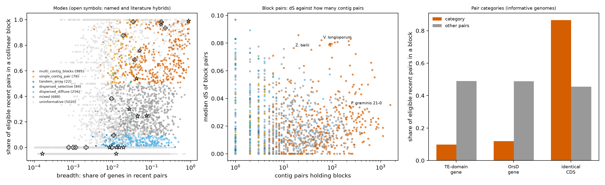

Question: can recent paralog pairs (dS <= 0.1) be separated into duplication of a subset of genes (tandem arrays, dispersed copies, enriched families) and block-scale duplication (whole-genome duplication, segmental duplication, hybrid with two assembled subgenomes, assembly duplication)? Method: `scripts/dup_mode.py` (definitions in its docstring) and `scripts/dup_mode_tests.py`. The first version of `dup_mode.py` was reviewed by an independent model reviewer. The review found a pair-ordering bug on single contigs, tRNA genes in the gene index, tandem runs counted as blocks, a null that was too easy, and an invalid z-score for Pfam composition. All were fixed in version 2, and the first version is kept in `scripts/legacy/dup_mode_v1.py`.

Status: interim (7,384-genome tables). The mode thresholds are exploratory and were not validated on held-out data.

## What the data can and cannot show

A pair is "in a block" when at least 2 pairs of a different family lie within 5 genes of both of its genes, on the same two contigs, in the same orientation. The null permutes gene order within each contig. Only genomes with at least 50 eligible recent pairs and a null block share <= 0.1 are classed (informative: 1,513 of 6,533). The others are too small, too fragmented or too dense for the test.

Gene order and dS cannot separate whole-genome duplication from a hybrid, a segmental duplication, or a duplicated assembly (haplotigs, duplicated scaffolds). They can separate block from non-block patterns. Old WGDs (Saccharomycetaceae, Mucorales) are older than the dS window and are not detected.

## H4.1 Known hybrids show block duplication and old WGD does not

**Hypothesis.** Named and literature hybrids have most recent pairs in collinear blocks that are spread over many contig pairs with one dS mode. Old WGD (Mucorales) does not register in the recent window.

**It would count against the hypothesis if:** hybrids are not in the block modes, or the null produces similar block shares.

**Test.** Mode of control genomes among informative genomes; block statistics of named examples. Verdict rule: PARTLY SUPPORTED if hybrids are in a block mode in >= 50% of classed hybrids and more often than the Mucorales controls.

**Result.** | control_group | multi_contig_blocks | single_contig_pair | dispersed_diffuse | dispersed_selective | tandem_array | mixed |
|---|---|---|---|---|---|---|
| Mucorales WGD | 0 | 0 | 16 | 0 | 1 | 4 |
| literature hybrid species (strain may be collapsed) | 3 | 1 | 0 | 0 | 0 | 1 |
| named hybrid (' x ' in name) | 2 | 0 | 1 | 0 | 0 | 2 |
| other | 370 | 76 | 239 | 84 | 21 | 672 |
| post-WGD Saccharomycetaceae | 3 | 1 | 0 | 0 | 0 | 8 |
| pre-WGD Saccharomycetaceae | 7 | 0 | 0 | 0 | 0 | 1 |

Hybrid controls in a block mode: 0.60 (6 of 10 classed). Mucorales WGD controls: 0.00.

Named examples:

| genome | n_eligible | breadth | share_block | share_block_null | n_blocks | n_block_contig_pairs | block_median_dS | block_dS_mad | informative | mode |
|---|---|---|---|---|---|---|---|---|---|---|
| Zygosaccharomyces_bailii_ISA1307 | 431 | 0.0892 | 0.984 | 0.0541 | 16 | 16 | 0.0764 | 0.011 | True | multi_contig_blocks |
| Zygosaccharomyces_rouxii_ATCC42981 | 233 | 0.0372 | 0.687 | 0.0327 | 16 | 15 | 0.00604 | 0.00504 | True | multi_contig_blocks |
| Ogataea_polymorpha_x_Ogataea_parapolymorpha_CBS_1977 | 5.41e+03 | 0.885 | 0.991 | 0.0714 | 269 | 261 | 0 | 0 | True | multi_contig_blocks |
| Aspergillus_latus_MO46169 | 152 | 0.00946 | 0.382 | 0 | 8 | 6 | 0.0154 | 0.00715 | True | mixed |
| Verticillium_longisporum_PD589 | 1.93e+03 | 0.179 | 0.982 | 0 | 246 | 60 | 0.0821 | 0.00653 | True | multi_contig_blocks |
| Puccinia_graminis_21-0 | 1.64e+04 | 0.655 | 0.601 | 0.000711 | 863 | 226 | 0.0345 | 0.0103 | True | multi_contig_blocks |
| Zygosaccharomyces_parabailii_PYCC5316 | 180 | 0.0336 | 0.983 | 0.594 | 7 | 7 | 0.0776 | 0.0113 | False | uninformative |

**Verdict: PARTLY SUPPORTED.** *V. longisporum* has 98% of eligible recent pairs in blocks (null 0.00) with 246 blocks on 60 contig pairs and a single dS mode (median 0.082, MAD 0.007). *Z. parabailii* has a dense-contig null (0.59) and is unclassed. *A. latus* has about 38% in blocks; its parental divergence lies above the window. The hybrid group is small (n = 10), and the pre-WGD Saccharomycetaceae controls are partly hybrids (Zygosaccharomyces), so they do not serve as negative controls.

## H4.2 Identical-CDS copies are mostly parts of duplicated regions, not scattered single genes

**Hypothesis.** Identical pairs are in blocks more often than other recent pairs of the same genome.

**It would count against the hypothesis if:** identical pairs are in blocks as rarely as other recent pairs.

**Test.** Share of eligible recent pairs in a block, identical-CDS pairs against other pairs, pooled and per genome (genomes with >= 5 identical pairs). Verdict rule: SUPPORTED if the pooled share is > 1.5 times the other share and > 70% of genomes show a higher share.

**Result.** | category | pairs | share_in_block_pooled | share_in_block_other_pairs_pooled | genomes_compared | median_share_category | median_share_other | frac_genomes_category_higher | p_wilcoxon |
|---|---|---|---|---|---|---|---|---|
| identical-CDS pair | 157673 | 0.866 | 0.455 | 1258 | 0.741 | 0.305 | 0.883 | 4.71e-179 |

**Verdict: SUPPORTED.** 0.87 of identical pairs are in blocks against 0.45 of other pairs, and 0.88 of 1258 genomes show a higher share. The excess of dS = 0 paralogs therefore mostly sits in duplicated regions. Whether the regions are real segmental duplications or assembly duplication is not separated here (see H4.4 and the single-contig-pair mode).

## H4.3 Recent copies of TE-domain genes and of the OrsD family are dispersed, not block duplicated

**Hypothesis.** Pairs that include a TE-domain gene or an OrsD gene are in blocks less often than other recent pairs of the same genome.

**It would count against the hypothesis if:** these pairs are in blocks as often as other pairs.

**Test.** Same test as H4.2 for pairs containing a gene with one of 15 TE Pfam domains, or a PF12013 gene. Verdict rule: SUPPORTED if both pooled shares are below half of the other-pair share.

**Result.** | category | pairs | share_in_block_pooled | share_in_block_other_pairs_pooled | genomes_compared | median_share_category | median_share_other | frac_genomes_category_higher | p_wilcoxon |
|---|---|---|---|---|---|---|---|---|
| pair has a TE-domain gene | 7553 | 0.0986 | 0.489 | 243 | 0.0385 | 0.281 | 0.119 | 1.95e-29 |
| pair has an OrsD gene | 4389 | 0.119 | 0.489 | 186 | 0.0184 | 0.388 | 0.14 | 9.04e-20 |

**Verdict: SUPPORTED.** TE-domain pairs: 0.10 in blocks against 0.49. OrsD pairs: 0.12 against 0.49. This fits copy-and-scatter duplication of these genes, as opposed to duplication of whole regions. It does not show that the copies are mobile elements. A low block share also arises if blocks are missed because of fragmented assemblies, but that applies equally to the other pairs of the same genomes.

## H4.4 Block-scale genomes are the ones with assembly-level duplication

**Hypothesis.** Genomes in the multi-contig block mode have higher BUSCO duplication and gene counts than genomes in dispersed modes.

**It would count against the hypothesis if:** BUSCO duplication does not differ between block and dispersed modes.

**Test.** Median BUSCO duplication, gene-count ratio, identical-pair share and block dS by mode; share of multi-contig-block genomes with BUSCO duplication >= 40%; Spearman correlation of block share with BUSCO duplication. Verdict rule: PARTLY SUPPORTED if the >= 40% share is higher in block genomes and rho > 0.15.

**Result.** | mode | genomes | med_breadth | med_share_block | med_busco_dup | med_gene_ratio | med_te_share | med_identical_pair_share | med_top5_family_share | med_block_dS |
|---|---|---|---|---|---|---|---|---|---|
| dispersed_diffuse | 256 | 0.0428 | 0.0393 | 0.9 | 1.03 | 0 | 0.0448 | 0.254 | 0.0136 |
| dispersed_selective | 84 | 0.0123 | 0.0183 | 0.4 | 0.964 | 0 | 0.0388 | 0.621 | 0.0138 |
| mixed | 688 | 0.0551 | 0.27 | 0.9 | 1.03 | 0 | 0.0861 | 0.166 | 0.0139 |
| multi_contig_blocks | 385 | 0.129 | 0.682 | 4.8 | 1.2 | 0 | 0.112 | 0.0678 | 0.0168 |
| single_contig_pair | 78 | 0.0175 | 0.778 | 0.8 | 1.04 | 0 | 0.339 | 0.121 | 0.000967 |
| tandem_array | 22 | 0.0356 | 0.0713 | 0.95 | 0.954 | 0 | 0.0948 | 0.119 | 0.021 |

**Verdict: PARTLY SUPPORTED.** 0.17 of 385 multi-contig-block genomes have BUSCO duplication >= 40%, against 0.02 of other informative genomes. Spearman rho (block share against BUSCO duplication) = 0.32 (p = 2.3e-36). Most block-mode genomes have low BUSCO duplication (median 4.8%), so they hold smaller duplicated regions or low-divergence blocks, not whole doubled genomes. The single-contig-pair mode has near-zero block dS (median 0.001) and a high identical share (0.34), which fits a duplicated scaffold or one segmental duplication.

## Modes by phylum (informative genomes)

| phylum | dispersed_diffuse | dispersed_selective | mixed | multi_contig_blocks | single_contig_pair | tandem_array |
|---|---|---|---|---|---|---|
| Aphelidiomycota | 0 | 0 | 1 | 0 | 0 | 0 |
| Ascomycota | 120 | 68 | 274 | 161 | 67 | 5 |
| Basidiobolomycota | 0 | 0 | 1 | 0 | 0 | 0 |
| Basidiomycota | 71 | 14 | 350 | 182 | 6 | 11 |
| Blastocladiomycota | 0 | 0 | 2 | 2 | 0 | 1 |
| Chytridiomycota | 1 | 0 | 9 | 9 | 1 | 1 |
| Entomophthoromycota | 0 | 0 | 1 | 1 | 0 | 0 |
| Glomeromycota | 5 | 0 | 2 | 0 | 0 | 0 |
| Kickxellomycota | 2 | 1 | 6 | 2 | 1 | 0 |
| Microsporidia | 1 | 1 | 14 | 21 | 1 | 0 |
| Monoblepharomycota | 0 | 0 | 1 | 1 | 0 | 0 |
| Mortierellomycota | 8 | 0 | 6 | 0 | 1 | 1 |
| Mucoromycota | 45 | 0 | 19 | 3 | 1 | 3 |
| Neocallimastigomycota | 3 | 0 | 2 | 0 | 0 | 0 |
| Zoopagomycota | 0 | 0 | 0 | 2 | 0 | 0 |
| unassigned | 0 | 0 | 0 | 1 | 0 | 0 |

## Figure

## Claims these data do not support

- That a genome is allopolyploid rather than autopolyploid.
- That a genome is a hybrid rather than a haplotig or scaffold duplication, without read depth or heterozygosity data.
- That a genome has no block duplication: most assemblies are fragmented (84% of recent pairs are between contigs) and 77% of genomes are unclassed.
- Absolute duplication rates or dates. Pairs are sampled (at most 5 per node), and identical CDS are collapsed.
- Any significance statement about Pfam composition. A permutation test that respects protein and family structure is not built.

## Follow-up queries that use the same tables

- Retention inside blocks (genes with a partner on both sides) and strand consistency from `gene_info.strand`.
- Synteny depth: number of distinct partner regions per region (2 fits WGD or a hybrid; higher fits repeated segmental duplication).
- Contig coverage and end-to-end blocks with dS near 0 for assembly duplication.
- For dispersed copies: number of contigs each family spans and TE-domain genes within 3 genes of each copy, against random genes.
- Repeat the analysis with a wider dS window (<= 0.3) for hybrids with older parents.

## Reproduce

`scripts/dup_mode.py`, `scripts/dup_mode_tests.py`, `scripts/make_h4_report.py`.
