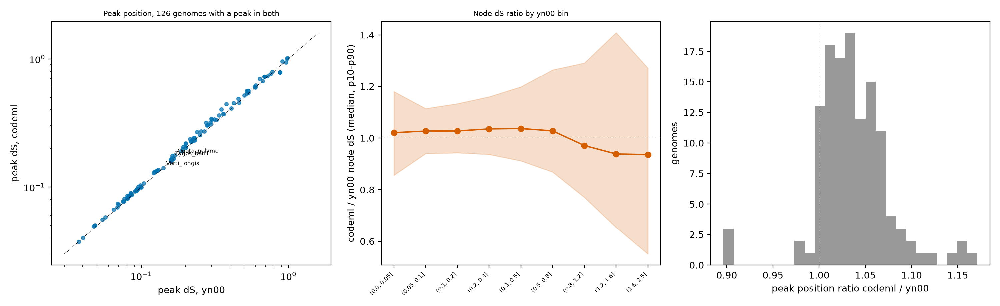

Follow-up to H4 (`reports/H4_duplication_mode.md`). Three additions: block-level descriptors (retention, strand concordance, copy depth, contig coverage), a wider recent window (dS <= 0.3, neighbours dS <= 0.5), and a codeml second pass for genomes with a possible interior dS peak (Option E). Scripts: `dup_mode.py` (env `DUP_RECENT`, `DUP_NBR`, `DUP_TAG`), `dup_block_tests.py`, `optionE_compare.py`, `option_e_codeml/`.

Status: interim (7,384-genome tables). Mode thresholds are exploratory.

## H5.1 Collinear blocks are real syntenic structures

**Hypothesis.** Gene strands in a block agree with the block orientation (direct blocks: same strand; inverted blocks: opposite strand). Strand is not used to call blocks, so agreement is independent evidence.

**It would count against the hypothesis if:** strand concordance is near 0.5 (the random expectation).

**Test.** Per block, share of pairs whose strand relation matches the block orientation; share of blocks with concordance >= 0.9, in informative genomes (window dS <= 0.1). Verdict rule: SUPPORTED if > 85% of blocks have concordance >= 0.9.

**Result.** | mode | genomes | blocks | median_pairs | strand_concordance | share_strand_concordance_ge_0_9 | retention | copies_median |
|---|---|---|---|---|---|---|---|
| dispersed_diffuse | 182 | 1.76e+03 | 3 | 1 | 0.887 | 0.75 | 2 |
| dispersed_selective | 37 | 80 | 3.5 | 1 | 0.887 | 0.879 | 2 |
| mixed | 686 | 3.08e+04 | 4 | 1 | 0.93 | 0.8 | 3 |
| multi_contig_blocks | 385 | 6.94e+04 | 6 | 1 | 0.959 | 0.765 | 2 |
| single_contig_pair | 78 | 381 | 5 | 1 | 0.958 | 0.875 | 2 |
| tandem_array | 14 | 60 | 4 | 1 | 0.833 | 0.8 | 2 |

All modes pooled: 0.949 of blocks have strand concordance >= 0.9. The expectation for unrelated pairs is 0.5 per gene pair.

**Verdict: SUPPORTED.** This supports the block calls as syntenic runs. It does not say what produced the duplication.

## H5.2 Hybrid and doubled-genome blocks are two-copy; repeated segmental duplication is multi-copy

**Hypothesis.** Genomes with a hybrid or whole-genome-like signal have blocks with copy number 2, while multi-copy blocks (copy number > 2) mark repeated segmental duplication.

**It would count against the hypothesis if:** named hybrids have as many multi-copy blocks as other block genomes.

**Test.** Copy number of a block = 1 + the number of other blocks that overlap its busiest region by >= 50%. Share of blocks with copies > 2 in named hybrids against the multi-contig-block mode. Verdict rule: SUPPORTED if the hybrid share is lower.

**Result.** | genome | blocks | median_pairs | retention | strand_concordance | copies_median | share_multi_copy | share_scaffold_like | coverage_smaller_contig | median_dS |
|---|---|---|---|---|---|---|---|---|---|
| Aspergillus_latus_MO46169 | 8 | 5 | 0.646 | 0.833 | 2 | 0.25 | 0 | 0.00495 | 0.0154 |
| Cryptococcus_neoformans_x_Cryptococcus_deneoformans_CBS_132 | 1 | 3 | 1 | 1 | 2 | 0 | 0 | 0.25 | 0.00409 |
| Ogataea_polymorpha_x_Ogataea_parapolymorpha_CBS_1977 | 269 | 13 | 1 | 1 | 2 | 0.193 | 0.543 | 0.95 | 0 |
| Puccinia_graminis_21-0 | 863 | 6 | 0.667 | 1 | 2 | 0.301 | 0.00232 | 0.0112 | 0.0345 |
| Verticillium_longisporum_PD589 | 246 | 4 | 0.5 | 1 | 2 | 0.0285 | 0 | 0.00654 | 0.0821 |
| Zygosaccharomyces_bailii_ISA1307 | 16 | 3 | 0.5 | 1 | 2 | 0 | 0 | 0.109 | 0.0764 |
| Zygosaccharomyces_parabailii_PYCC5316 | 7 | 3 | 0.75 | 1 | 2 | 0 | 0 | 0.308 | 0.0776 |

Mean share of multi-copy blocks: four named hybrids 0.055; multi-contig-block mode 0.424.

**Verdict: SUPPORTED.** *V. longisporum* and the *Zygosaccharomyces* genomes have 0-3% multi-copy blocks. *Puccinia graminis* 21-0 has about 30%, which fits repeated duplication inside a two-haplotype assembly. Sampled pairs under-count partners in large families, so copy number is a lower bound.

## H5.3 Some block genomes are duplicated scaffolds or doubled assemblies

**Hypothesis.** Blocks that cover >= 80% of the smaller contig with median dS <= 0.01 mark whole duplicated contigs (assembly duplication) and are concentrated in a minority of genomes.

**It would count against the hypothesis if:** such blocks are spread evenly over all genomes.

**Test.** Per genome, share of blocks that are scaffold-like. Count genomes with >= 50% scaffold-like blocks.

**Result.** 35 of 1382 informative genomes with blocks have >= 50% scaffold-like blocks. In the *Ogataea polymorpha x parapolymorpha* hybrid genome 0.54 of 269 blocks are scaffold-like (median block coverage 0.95, median dS 0.000).

**Verdict: DESCRIPTIVE.** Scaffold-like blocks fit duplicated contigs or a doubled assembly. A real near-identical homeolog pair would look the same. Read depth or contig-level alignment would separate them.

## H5.4 A wider window (dS <= 0.3) recovers genome-scale duplication in hybrids whose copies diverged beyond 0.1

**Hypothesis.** With the wider window, more genomes become informative and hybrids show breadth near 1 instead of a fraction.

**It would count against the hypothesis if:** the number of informative genomes and hybrid breadth do not change.

**Test.** Informative genomes (>= 50 eligible recent pairs, null block share <= 0.1) and named-genome breadth and block share for both windows.

**Result.** Informative genomes: 1,513 (window 0.1) and 2,227 (window 0.3).

| genome | breadth_w01 | breadth_w03 | share_block_w01 | share_block_w03 | null_w03 | mode_w01 | mode_w03 |
|---|---|---|---|---|---|---|---|
| Ogataea_polymorpha_x_Ogataea_parapolymorpha_CBS_1977 | 0.885 | 0.991 | 0.991 | 0.956 | 0.113 | multi_contig_blocks | uninformative |
| Saccharomyces_pastorianus_CBS_1484 | 0.00975 | 0.0367 | 0 | 0.0359 | 0 | uninformative | dispersed_diffuse |
| Zygosaccharomyces_bailii_ISA1307 | 0.0892 | 0.949 | 0.984 | 0.99 | 0.0535 | multi_contig_blocks | multi_contig_blocks |
| Zygosaccharomyces_mellis_6-7431 | 0.19 | 0.959 | 0.981 | 0.993 | 0.00606 | multi_contig_blocks | multi_contig_blocks |
| Verticillium_longisporum_PD589 | 0.179 | 0.828 | 0.982 | 0.986 | 0 | multi_contig_blocks | multi_contig_blocks |
| Aspergillus_latus_MO46169 | 0.00946 | 0.0161 | 0.382 | 0.331 | 0 | mixed | mixed |
| Zygosaccharomyces_parabailii_PYCC5316 | 0.0336 | 0.613 | 0.983 | 0.992 | 0.602 | uninformative | uninformative |
| Cryptococcus_neoformans_x_Cryptococcus_deneoformans_CBS_132 | 0.044 | 0.274 | 0.244 | 0.816 | 0.191 | uninformative | uninformative |
| Zygosaccharomyces_pseudobailii | 0.0875 | 0.879 | 0.935 | 0.99 | 0.00424 | multi_contig_blocks | multi_contig_blocks |
| Puccinia_graminis_21-0 | 0.655 | 0.792 | 0.601 | 0.505 | 0.000606 | multi_contig_blocks | multi_contig_blocks |

**Verdict: SUPPORTED.** The window ties the interpretation to dS: *V. longisporum* blocks have median dS 0.14 and *Z. bailii* 0.16, both above the first window. *A. latus* stays 'mixed' (block share 0.33). The *Cryptococcus* AD hybrid has a null block share of 0.19 at the wider window and stays unclassed.

## H5.5 Genome-scale block genomes form a candidate list that overlaps assembly evidence

**Hypothesis.** Genomes with breadth >= 0.3, block share >= 0.5 and blocks on >= 5 contig pairs (window 0.3) also show high BUSCO duplication or a sharp interior peak.

**It would count against the hypothesis if:** BUSCO duplication and peak tiers are no higher in the candidates than in other informative genomes.

**Test.** Candidate list from `dupmode_genome_scale_candidates_w03.tsv`; BUSCO duplicated-% bins; overlap with shape tiers A and B; genera.

**Result.** 129 candidate genomes; 77 Basidiomycota, 28 Ascomycota, 16 Microsporidia. Shape tier A or B: 28; any interior peak <= 1.0: 91.

| BUSCO dup % | genomes |
|---|---|
| <10 | 15 |
| 10-40 | 56 |
| >=40 | 58 |

Largest genera:

| genus | genomes |
|---|---|
| Mycena | 13 |
| Apiotrichum | 6 |
| Amblyosporidae | 5 |
| Epichloe | 5 |
| Nosema | 4 |
| Lactarius | 4 |
| Pisolithus | 3 |
| Vairimorpha | 3 |
| Armillaria | 3 |
| Zygosaccharomyces | 3 |

First 25 by breadth:

| genome | class | breadth | share_block | share_block_null | n_block_contig_pairs | block_median_dS | block_dS_mad | busco_dup | genes_ratio_clade | tier |
|---|---|---|---|---|---|---|---|---|---|---|
| Amblyosporidae_sp._gmOTU1_NHMUK015059140 | Microsporidia/unassigned | 0.964 | 0.84 | 0.044 | 665 | 0.0686 | 0.0194 | 10.2 | 6.36 | D broad hump |
| Lentinula_aciculospora_JLM2183 | Agaricomycetes | 0.962 | 0.647 | 0.00878 | 226 | 0.00114 | 0.00114 | 92.2 | 1.76 |  |
| Zygosaccharomyces_mellis_6-7431 | Saccharomycetes | 0.959 | 0.993 | 0.00606 | 20 | 0.125 | 0.0013 | 64.3 | 1.89 | A sharp + BUSCO dup>=40% |
| Zygosaccharomyces_bailii_ISA1307 | Saccharomycetes | 0.949 | 0.99 | 0.0535 | 108 | 0.159 | 0.00646 | 64.1 | 1.97 | A sharp + BUSCO dup>=40% |
| Lodderomyces_metapsilosis_414 | Pichiomycetes | 0.948 | 0.946 | 0.00464 | 72 | 0.146 | 0.0212 | 70.9 | 2.23 | A sharp + BUSCO dup>=40% |
| Nosema_sp._gmOTU20_Ox002937 | Microsporidia/unassigned | 0.934 | 0.896 | 0.0072 | 251 | 0.0385 | 0.0169 | 10.3 | 3.25 | D broad hump |
| Amblyosporidae_sp._gmOTU10_Ox001727 | Microsporidia/unassigned | 0.929 | 0.85 | 0.0026 | 256 | 0.0942 | 0.0888 | 10.2 | 3.95 | D broad hump |
| Apiotrichum_sp._Y4201-1_Y4201-1 | Tremellomycetes | 0.928 | 0.998 | 0.0395 | 146 | 0.151 | 0.0176 | 74.7 | 1.85 | A sharp + BUSCO dup>=40% |
| Epichloe_coenophiala_ATCC_90664 | Sordariomycetes | 0.926 | 0.979 | 0.00485 | 714 | 0.0683 | 0.0194 | 91.5 | 1.99 | A sharp + BUSCO dup>=40% |
| Apiotrichum_sp._PDH3304B_PDH3304B | Tremellomycetes | 0.925 | 0.997 | 0.0464 | 170 | 0.153 | 0.0171 | 75 | 1.86 | A sharp + BUSCO dup>=40% |
| Apiotrichum_sp._PA4207_PA4207 | Tremellomycetes | 0.924 | 0.998 | 0.061 | 177 | 0.151 | 0.0175 | 74.9 | 1.87 | A sharp + BUSCO dup>=40% |
| Apiotrichum_sp._PL3309B_PL3309B | Tremellomycetes | 0.924 | 0.998 | 0.0397 | 177 | 0.153 | 0.0171 | 74.2 | 1.86 | A sharp + BUSCO dup>=40% |
| Apiotrichum_sp._Y4204_Y4204 | Tremellomycetes | 0.923 | 0.997 | 0.0369 | 145 | 0.149 | 0.0163 | 74.9 | 1.86 | A sharp + BUSCO dup>=40% |
| Apiotrichum_sp._PL3306B_PL3306B | Tremellomycetes | 0.923 | 0.997 | 0.0494 | 174 | 0.151 | 0.0174 | 74.2 | 1.86 | A sharp + BUSCO dup>=40% |
| Nosema_muscidifuracis_AU001 | Microsporidia/unassigned | 0.921 | 0.789 | 0.0144 | 107 | 0.0184 | 0.0184 | 10.2 | 2.23 |  |
| Puccinia_triticina_Pt76 | Pucciniomycetes | 0.921 | 0.505 | 0.000672 | 327 | 0.00919 | 0.00919 | 89.3 | 2.84 |  |
| Candida_sanyaensis_UCD423 | Pichiomycetes | 0.918 | 0.946 | 0.0289 | 272 | 0.0382 | 0.0119 | 59.9 | 2.28 | D broad hump |
| Cryomyces_antarcticus_CBS_116301 | Dothideomycetes | 0.916 | 0.967 | 0.012 | 178 | 0.0082 | 0.00625 | 87.7 | 1.72 |  |
| Scleroderma_citrinum_hr | Agaricomycetes | 0.908 | 0.812 | 0.00691 | 147 | 0.000276 | 0.000276 | 89.9 | 1.72 |  |
| Nosema_sp._gmOTU22_Ox000071 | Microsporidia/unassigned | 0.896 | 0.922 | 0.00789 | 206 | 0.0432 | 0.0409 | 8.1 | 3.51 | D broad hump |
| Epichloe_hybrida_Lp1 | Sordariomycetes | 0.894 | 0.967 | 0.00513 | 346 | 0.0868 | 0.0171 | 86.3 | 1.44 | A sharp + BUSCO dup>=40% |
| Zygosaccharomyces_pseudobailii | Saccharomycetes | 0.879 | 0.99 | 0.00424 | 25 | 0.212 | 0.00832 | 61.2 | 1.88 | A sharp + BUSCO dup>=40% |
| Epichloe_sp._1_LKC-2024_1_LKC-2024 | Sordariomycetes | 0.876 | 0.986 | 0.00102 | 126 | 0.0996 | 0.00942 | 83.3 | 1.29 | A sharp + BUSCO dup>=40% |
| Epichloe_sp._2_LKC-2024_2_LKC-2024 | Sordariomycetes | 0.875 | 0.988 | 0 | 143 | 0.099 | 0.00911 | 82.7 | 1.28 | A sharp + BUSCO dup>=40% |
| Epichloe_sp._FaTG-3_NFe1100 | Sordariomycetes | 0.861 | 0.984 | 0.00777 | 256 | 0.0954 | 0.0106 | 76.4 | 1.26 | A sharp + BUSCO dup>=40% |

**Verdict: DESCRIPTIVE.** The list is a screen. Several strains of one genus count as separate genomes (for example the Apiotrichum strains), so the number of independent events is lower than the number of genomes. Microsporidia entries have BUSCO duplication near 10% and gene counts several times the clade median; they need a separate check for contamination or assembly doubling.

## H5.6 yn00 peak positions below dS 1.0 are close to codeml positions

**Hypothesis.** For genomes with an interior peak, the peak position from codeml is within 10% of the yn00 position, so the screens (H1, H4, H5) do not move when the estimator changes.

**It would count against the hypothesis if:** codeml peak positions differ from yn00 by more than 10% in most genomes.

**Test.** Same pairs-per-node sampling and gates; codeml run on 127 genomes with a possible peak (shape tiers A to C, excluding 8 genomes that already had codeml). The shape detector is applied to codeml node dS; the position is the median node dS inside the peak window. Verdict rule: SUPPORTED if >= 70% of genomes have a ratio between 0.9 and 1.1.

**Result.** Peak detected in both estimators: 126 of 127 genomes. Position ratio codeml / yn00: median 1.032, 10th-90th percentile 1.004 to 1.079; 0.93 of genomes within 10%.

| bin | n_nodes | median_yn00 | median_codeml | median_ratio | p10 | p90 | share_within_20pct |
|---|---|---|---|---|---|---|---|
| (0.0, 0.05] | 30336 | 0.0377 | 0.038 | 1.02 | 0.856 | 1.18 | 0.894 |
| (0.05, 0.1] | 112704 | 0.0759 | 0.0777 | 1.03 | 0.94 | 1.11 | 0.964 |
| (0.1, 0.2] | 149289 | 0.143 | 0.147 | 1.03 | 0.943 | 1.13 | 0.95 |
| (0.2, 0.3] | 93298 | 0.244 | 0.253 | 1.04 | 0.937 | 1.16 | 0.931 |
| (0.3, 0.5] | 92701 | 0.383 | 0.396 | 1.04 | 0.912 | 1.2 | 0.882 |
| (0.5, 0.8] | 83696 | 0.631 | 0.648 | 1.03 | 0.868 | 1.26 | 0.811 |
| (0.8, 1.2] | 54710 | 0.951 | 0.925 | 0.971 | 0.771 | 1.29 | 0.709 |
| (1.2, 1.6] | 23799 | 1.37 | 1.27 | 0.938 | 0.654 | 1.41 | 0.478 |
| (1.6, 2.5] | 14910 | 1.82 | 1.74 | 0.936 | 0.551 | 1.27 | 0.465 |

**Verdict: SUPPORTED.** This node-level result differs from the earlier wave-1 comparison (300 genomes, `tables/yn00_vs_codeml_nodes_binned.tsv`), which gave codeml / yn00 ratios of 1.08 to 1.13 for yn00 dS 0.2 to 1.6. Here the ratio is about 1.03 below dS 0.8 and 0.94 to 0.97 above 0.8. The genome sets differ (wave-1: all taxa; here: genomes with a possible peak) and the node matching differs. I have not resolved the difference. One untested possibility is regression to the mean, because nodes are binned by the yn00 value and the two runs sample different pairs. What this test does show is that peak positions below dS 1.0 agree within 10% in most genomes. Peaks above dS 1.0 are not assessed. One genome (Hemileccinum hortonii, tier C) has a peak with yn00 and none with codeml.

## Follow-ups

- Contig-level alignment or read depth for the scaffold-like genomes and for the candidate list, to separate duplicated assemblies from real hybrids.
- Treat strains of one genus (for example Apiotrichum) as one candidate event.
- Microsporidia candidates: check contamination and assembly doubling.
- Phase the two block partners in V. longisporum, Z. bailii and Epichloe coenophiala against relatives (gene-tree placement) to test for allopolyploidy; gene order and dS cannot do this.
- Rerun on the final tables.

## Reproduce

`DUP_TAG= scripts/dup_mode.py`; `DUP_RECENT=0.3 DUP_NBR=0.5 DUP_TAG=_w03 scripts/dup_mode.py`; `scripts/dup_mode_tests.py` and `scripts/dup_block_tests.py` (same env); `option_e_codeml/select_genomes.py`, `submit_array.sh`; `scripts/optionE_compare.py`; `scripts/make_h5_report.py`.
